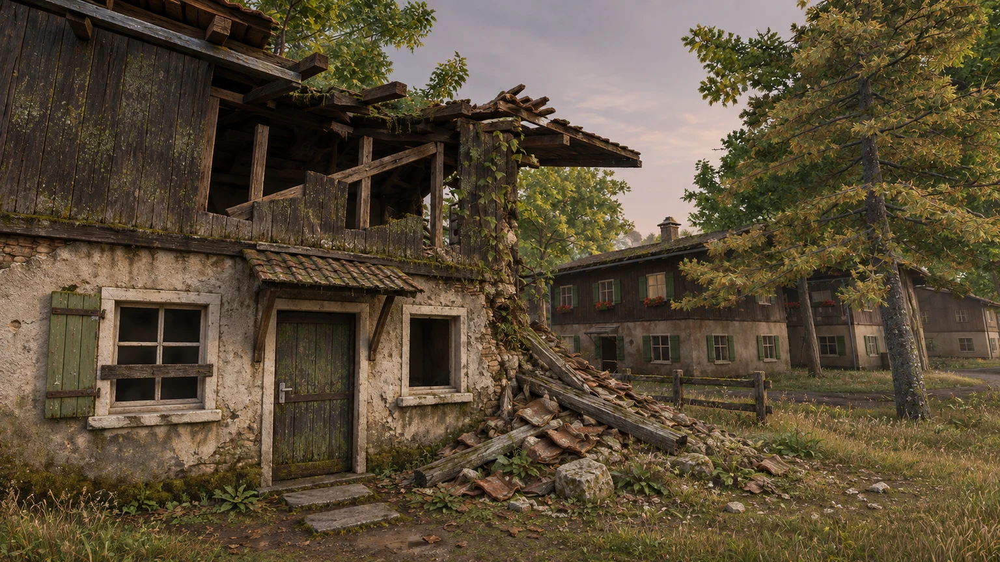
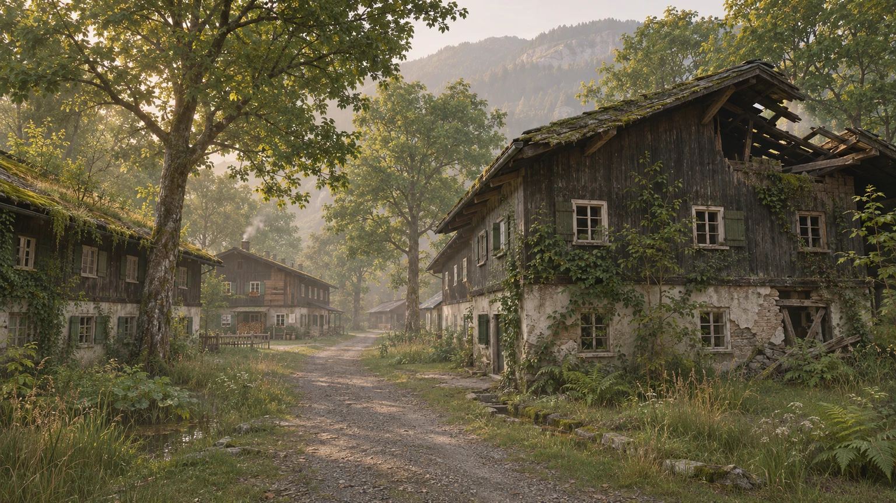

# Hof-Zielbilder für BRACHLAND

Der Hof im Œntal zeigt 40–60 Jahre nach dem Kollaps drei Zustände auf engem Raum: ein eingestürztes Haus, ein verlassenes Haus mit intakter Silhouette und, wo Bewohner verortet sind, geflickte Bauten. Das Mauerwerk aus Feldstein und Kalkputz, das hölzerne Obergeschoss und das flache Satteldach geben dem Ort seine Inntaler Identität. [Story-Bibel](design/BRACHLAND_Story-Bibel_v1.md) · [Bauwelt](design/BRACHLAND_Bauwelt_v1.md)

## Gesichtet am 18.11.2026

| Referenz | Im Bild beobachtet | Ziel für den Hof |
|---|---|---|
| **S.T.A.L.K.E.R. 2, World & Locations** | Ein Haus mit erhaltenem Satteldach steht neben einem Bau mit offenem Dachstuhl. Warmes Seitenlicht fällt auf Bruchkanten und einen durchbrochenen Holzzaun. Ein schmaler brauner Pfad bleibt zwischen den Büschen sichtbar. | Leitmotiv für den Hof. Verfallsstufen nebeneinander lesbar machen. Vegetation wächst von Rändern und Fugen in die Gasse, Feuchte sammelt sich in Senken. [Offizieller Clip bei 1:50](https://www.youtube.com/watch?v=Z5TmiZUOosE&t=110s) · [Publisher-Spielbild zum Boden](https://shared.akamai.steamstatic.com/store_item_assets/steam/apps/1643320/6dd918e8d8fd9697b281cffa9ca3d8935f5d870d/ss_6dd918e8d8fd9697b281cffa9ca3d8935f5d870d.1920x1080.jpg) |
| **The Last of Us Part II, Hillcrest** | Bruch in der Dachsilhouette, dichter Bewuchs an Gebäudekanten und in Rissen, lesbare Lücken auf der feuchten Straße. Vordergrundlaub und dunstige Hügel geben Tiefe. | Efeu vom Sockel über die Fassade wachsen lassen. Büschel an Fugen und Rändern verdichten. Einen sichtbaren Gehstreifen lassen. [Offizielles Spielbild](https://live.staticflickr.com/65535/48797065106_7e4fa520dd_h.jpg) · [PlayStation](https://blog.playstation.com/2019/09/26/new-the-last-of-us-part-ii-gameplay-details-revealed/) |
| **Metro Exodus, ländliche Holzhausgruppe** | Verwittertes graues Holz neben dunklen Giebelöffnungen, helle Balkenkanten und hohes Gras an Resten von Zäunen. Bodendunst trennt die hinteren Gebäude. | Ausgebleichtes Holz im Licht, dunkles, gealtertes Holz unter der Traufe. Eine tragende Konstruktion bleibt im Bruch erkennbar. [Publisher-Spielbild](https://shared.akamai.steamstatic.com/store_item_assets/steam/apps/412020/ss_f0f073a59827827ab32960ae280f178b4d89732b.1920x1080.jpg) · [Galerie](https://store.steampowered.com/app/412020/Metro_Exodus/) |
| **Days Gone, ländliches Anwesen** | Graues Holzhaus und dichter Bewuchs am Sockel. Der freie Erdweg zieht durch das Bild, warmes Streiflicht und kühler Walddunst trennen die Ebenen. | Weg und Lichtrichtung als Führung. Alte Gegenstände oder Schutt an wenigen plausiblen Stellen konzentrieren. Die Verfallsstufe richtet sich nach der längeren Zeitspanne in BRACHLAND. [Publisher-Spielbild](https://shared.akamai.steamstatic.com/store_item_assets/steam/apps/1259420/ss_7b63c1b0d9bd6e3951a1358f374ecd473e0f10b0.1920x1080.jpg?t=1750947718) · [Bend Studio zur Zeitspanne](https://blog.playstation.com/2019/04/19/how-bend-studio-built-the-merciless-world-of-days-gone/) |

## 1. Einsturz und Efeu an Haus 308


**Soll im Lauf aus Spielhöhe erkennbar sein:** Der Schaden setzt sich als zusammenhängende Spur vom abgesackten Dach über die gebrochene Schalung bis unter die Öffnung fort. Licht trennt ausgefaserte Kanten vom Innenraum. Kräftige, bodengebundene Efeutriebe fassen die Ecke ein und werden nach oben unregelmäßig dünner. Das Blattwerk hat sichtbare Lücken, Giebel und Dachüberstand bleiben ablesbar.

**Abstand zu D314:** Der bestehende Bruch hat noch gleichförmige Balken, eine gestufte Bretterkante und vergleichsweise dünnen Efeu. Die größte sichtbare Änderung liegt zuerst in der Silhouette und im Materialkontrast der Bruchflächen.

## 2. Sockel, Tür und Schutt



**Soll beim Vorbeigehen erkennbar sein:** Direkt unter dem Bruch liegen das gröbste Holz und die schwersten Steine. Nach außen lösen sie sich in Ziegelscherben, Splitter, feuchte Erde und einzelne Triebe auf. Die Trittplatten bleiben in der Spur zur Tür sichtbar. Kalkputz platzt bis auf mineralische Körnung und Fugen ab. Unter Fensterbänken, an der Sockelkante und im Regenabfluss zeigen sich unterschiedliche Feuchtespuren.

**Abstand zu D314:** Der kleine Schutthaufen sitzt bereits seitlich der Tür. Im Zielbild ist seine Verbindung zur Bruchstelle über gefallenes Holz sichtbar. Mehr Materialtiefe lässt sich aus einer gemeinsamen Maske für Farbe, Rauheit und Normalen gewinnen. Die Bruchkante am Mauerwerk wird nur da als Geometrie gesetzt, wo sie aus Spielhöhe Tiefe oder Silhouette verändert.

## 3. Gasse und Verfallsstufen



**Soll beim Anlaufen erkennbar sein:** Eine zusammenhängende, begangene Mitte führt durch die Gasse. Farn, Gräser und Sträucher stehen gestaffelt am Mauerfuß und an feuchten Rändern. Jeder Bau behält eine eigene Silhouette. Dachbruch, Moosdach und geflicktes Holz zeigen Unterschiede im Zustand. Pflegezeichen wie Rauch oder frischere Bretter setzen eine tatsächliche Bewohnung voraus. Warmes Streiflicht hebt vereinzelte Kanten, und der Dunst trennt die hinteren Häuser.

**Abstand zu D314:** Der Spielstand hat viele gleichmäßig niedrige Halme und relativ glatte Ränder. Mehr Wirkung entsteht durch wenige dichte Gruppen, ausgefranste Wegränder und hellere Abstufungen in der Ferne.

## Kameras für den Vergleich

Alle Angaben folgen `kamera=x,y,z,zielX,zielY,zielZ&fov=60`. Der beste Rückvergleich nutzt zuerst dieselben Ansichten mit `stimmung=zielbild` und anschliessend die Bewegung. Das Konzeptbild für den Sockel ist bewusst etwas tiefer eingerahmt, damit die Trittplatten ganz im Bild liegen.

| Bild | Spielaufnahme | Kamera und Ziel im Ausgangsbild |
|---|---|---|
| 1 | `hauslauf.mjs <name> 1 fahrt ruine`, Bild 064 | `1428.529,36.400,403.898,1426.084,37.884,409.300` |
| 2 | dasselbe Profil, Bild 183 | `1434.822,36.325,410.344,1426.240,38.040,409.300` |
| 3 | `hauslauf.mjs <name> 1 fahrt verfall`, Bild 143 | `1447,36.4,436,1457,38,432` |

Für die Umsetzung werden zuerst die Bruchsilhouette von Haus 308, dann Material und Schuttstaffelung, anschließend die Gasse verglichen. Die drei Konzeptbilder geben Motive, Materialverhalten und Licht vor. Für numerischen Bildvergleich dient ein eigener Blender-Render mit derselben Kamera nach [ADR-0006](adr/0006-zielbild-vor-zielgeraet.md). Der [Messlauf](MESSLAUF.md) prüft zusätzlich Bewegung und Bildzeiten im spielbaren Ausschnitt.

## Bildherkunft

Die drei Konzeptbilder wurden mit dem eingebauten ImageGen-Werkzeug aus eigenen BRACHLAND-Spielaufnahmen erstellt und als WebP mit 1536 × 864 Pixeln abgelegt. Die AAA-Spielbilder sind als Quellen verlinkt.

<details>
<summary>Bildprompts und verwendete Spielaufnahmen</summary>

### Zielbild 1

Eingabe `.cache/mess/d314-nach/064.png` aus der oben genannten Messkette.

```text
Use case: stylized-concept. Asset: BRACHLAND visual target, damaged alpine farm from ordinary gameplay eye height, wide landscape. Image 1 is OUR game's camera and building reference. Preserve the view angle, two-story Inn valley farmhouse, corner, dark horizontal timber beam, shallow gable, plaster base fieldstone plinth, entrance and real single connected ivy climbing around the corner. Render a grounded human-scaled rural collapse after fifty years. One roof bay has genuinely sagged and failed with irregular fractured rafters, fractured and curled gray-brown cladding, layered breaks, and an interior shadow cavity with legible depth. Rooted European ivy forms dense overlapping leaves around that corner, with stem and young growth, intermittent bare wood. Soft amber overcast sky, cool bounce under eaves, quiet mist in distance. Materials should read in the mids and one could implement it as a real-time game. Original design. Avoid any game-identifiable imagery, sci-fi, fantasy effects, fire, violence, text, UI, and excessive saturation.
```

### Zielbild 2

Eingabe `.cache/mess/d314-nach/183.png` aus der oben genannten Messkette.

```text
Use case: stylized-concept. Asset: BRACHLAND visual target of ground-level weathering and collapse debris, wide landscape. Image 1 is OUR gameplay location and framing reference for the same original Inn valley farm. Keep the existing paired entrance and window on the left half with visible pale local aggregate plaster, wood framing upstairs and broken roof silhouettes. Lower the aim a little to show the entire doorstep and rubble fan. Fifty years after collapse. From the damaged bay a connected pile of layered roof tiles, fallen gray wood and irregular limestone rubble decreases gradually into small scattered chips, damp soil and weeds. Keep two visibly clear door stepping stones next to the debris. Local damp stains at stone base, eroded lime plaster with exposed mortar, wet wood below eaves, dry silver faces in soft warm afternoon. Windows recessed with a dull dark interior. Modest lived-in architecture, natural seasonal grass, weathered muted tones, a credible realtime game framing. Original design. No UI, characters, fireworks, text, or brands.
```

### Zielbild 3

Eingabe `.cache/mess/d312-nach/143.png` aus der oben genannten Messkette.

```text
Use case: stylized-concept. Asset: BRACHLAND visual target, approach through a reclaimed Inn valley farm lane, wide landscape, game camera about two meters high. Image 1 is OUR game composition and architecture reference. Preserve rows of two-story alpine farmhouses with plaster ground floor, wooden upper floors, broad shallow dark gabled roofs, tree-lined depth, and route into the middle distance. Set it fifty years after collapse under soft hazy golden daylight. Show visibly distinct fates: one near ruined bay with missing rafters and a dark roof hole, one abandoned intact mossy roof where shrubs colonize a wet edge, a distant discreet repaired inhabited building with patched timber and small hints of maintained ground. Groundcover grows from verges, wall toes and old drainage, in uneven clumps of ivy, ferns, saplings and tall grasses among broken verge edges. Keep a readable continuous band of foot-worn gravel along the middle and clear access patches. Restrained muted greens, weathered gray wood, pale stone and subtle mountain haze; natural bounce with silhouette separation. Original design, camera remains credible at running speed, no text, no HUD, no urban skyline, no fire or fantasy glow.
```

</details>

## Spielbare Fassung von Haus 308 (D317)

`node tools/mess/hauslauf.mjs <name> 1 fahrt hofziel` erfasst die Hausruine aus denselben Kamerapositionen wie D316. Mit Probe `0` läuft der D316-Vergleich. Bild 064 ist der direkte Rückvergleich zum Konzept oben. Die neue Spielvariante nutzt `hofziel=1` und die separate Lichtstimmung `stimmung=hofziel`.

Der Vergleich liegt lokal unter `.cache/bilder/d317-hof-zielbild/index.html`. Die acht Sekunden Fahrt verwenden 192 Bilder pro Fassung bei 24 Bildern pro Sekunde. Die geladene Haus- und Gartengeometrie steigt von 406.999 auf 411.781 Dreiecke. Der Dachüberstand, die Tiefe des Bruchs und die Dichte des Efeus weichen im Spiel noch vom Konzeptbild ab.

Vier separate 12-s-Spielmessungen am M1 bei 960 × 540 und gleicher Beleuchtung (`stimmung=hofziel`) schalten am Startpunkt 1436/398/171 nur `hofziel` in der Reihenfolge 0/1/1/0 um. Im Mittel ergeben sich 45,68 → 46,00 FPS und 33,65 → 33,70 ms p95. Die längsten Einzelbilder liegen bei 50,9 ms ohne und 67,8 ms mit Probe. In beiden neuen Läufen trat je ein Bild über 50 ms auf, in den beiden Gegenläufen zusammen eines. Die Stichprobe reicht für die Einordnung des stabilen Bildzeitniveaus im Ausschnitt, größere Einzelspitzen bleiben messbar. Rohberichte unter `.cache/mess/d317-fps-{1,2,3,4}`.

Die vier Karten für Kalkputz, Schalung, Schindeldach und Feldsteinsockel wurden mit ImageGen aus dem obigen eigenen Zielbild als vier Quadranten erzeugt, zugeschnitten und mit umlaufenden Filtrierungsrändern in einen WebP-Atlas gepackt. Die Normalenkarte leitet ihr Relief aus Helligkeitsgradienten ab. Beide Atlanten sind 1280 × 1280 Pixel groß.

<details>
<summary>Prompt für die Materialkarten</summary>

```text
Use case: stylized-concept. Make a new 1:1 square texture swatch image divided exactly into four equal square quadrants that touch with no separators or borders. It will be cropped at the halfway lines to make four PBR base color maps for BRACHLAND's own original farmhouse. The supplied BRACHLAND rendering is our material reference only. Extract the same authentic hues and material meaning at the same human scale. Top-left quadrant: pale lightly warm beige lime render with flat peeling areas and exposed grey-brown stone aggregate, a fine small network of cracks, mineral colors, with fissures no bigger than a few centimeters. Top-right quadrant: very old faded gray-brown timber plank cladding, boards aligned strictly vertical in the image, irregular shallow scratches, dark thin seams, gray wood fibers, rough dryness, no visible moss and no large damage holes. Bottom-left quadrant: irregular weathered grey wooden roof shingles aligned in horizontal rows, some silver tones and warm grey, touches of thin brown-green moss in the seams, natural aged roof. Bottom-right quadrant: small dark charcoal-brown fieldstones with brown mortar and fine gray textures, scattered muted moss. Every quadrant is a flat evenly lit, orthographic seamless PBR base color texture crop, no scene perspective, no shadows, no depth of field, no light gradients, no vignettes. No architecture objects, windows or trims. No text, no graphic layout, no frame or gutters. Four equally sized fully filled materials. Heavy physical realism at ground level, muted natural colors.
```

</details>

## Dachbruch und Efeu (D318)

`node tools/mess/hauslauf.mjs <name> 1 fahrt hofdachbruch` nutzt dieselbe Kamerafahrt wie D317. Probe `0` ruft D317 auf. D318 ergänzt an Haus 308 die abgesackte, weit in die Öffnung ragende Schindelhaut, übereinander verkeilte Holzstücke, einen tiefer liegenden Innenraum, dichteren Efeu und den bemoosten Sockel. Die Variante verwendet die D317-Materialkarten bei wärmerem Himmelslicht. Eingang und Trittplatten bleiben frei.

Der lokale Vergleich unter `.cache/bilder/d318-hof-dachbruch/index.html` zeigt Zielbild, D317 und D318 nebeneinander. Beide Spielaufnahmen nutzen 192 Bilder über acht Sekunden. Die geladenen Haus- und Gartenpuffer steigen von 411.781 auf 422.536 Dreiecke. Der Spielrender behält die ursprünglichen Hausgrundrisse und weicht durch die Dachform und die Himmelsbeleuchtung sichtbar von der Vorlage ab.

Ein Raster aus 96 × 54 Sichtstrahlen an Kamera 064 trifft am isolierten Haus 308 in D317 bei 290 von 2.322 Haustrefferpunkten auf Efeublätter. In D318 sind es 422 von 2.391. Der Anteil steigt von 12,5 auf 17,6 %. Die Messung nutzt das originale Höhenfeld und betrachtet die Geometrie ohne vorstehende Geländeobjekte.

Vier getrennte 12-s-Spielmessungen am M1 bei 960 × 540, Startpunkt 1436/398/171 und identischer Beleuchtung (`stimmung=hofdachbruch`) schalten nur `hofdachbruch` in der Reihenfolge 0/1/1/0 um. Die Mittelwerte betragen 47,04 → 46,79 FPS und 33,4 → 33,6 ms p95. Längstes Einzelbild 35,3 → 50,6 ms. In der neuen Fassung gab es über beide Läufe ein Bild über 50 ms. Rohberichte unter `.cache/mess/d318-fps-{1,2,3,4}`.

## Hoflicht aus der Blender-Probe (D319)

Die Blender-Probe vergleicht auf dem D318-Mesh und mit Kamera 064 hartes Sonnenlicht, breitere Schatten und eine zusätzliche flächige Aufhellung. Die Spielvariante nähert die Aufhellung über die Oberflächenausrichtung im Hausshader an. Helligkeit und warme Tönung konzentrieren sich an Holz, Traufe und Efeu von Haus 308. Der Filterradius derselben Sonnen-Schattenkarte blendet zwischen 44 und 65 m Hofabstand des Spielers zurück.

`node tools/mess/hauslauf.mjs <name> 1 fahrt hoflicht` zeichnet die neue Fassung auf. Probe `0` läuft mit derselben Kamera, Stimmung und Geometrie wie D318. Der Rückschalter lautet `hoflicht=0`.

Der lokale Vergleich unter `.cache/bilder/d319-hoflicht/index.html` zeigt acht Sekunden Bewegung in beiden Fassungen. Die 20 geladenen Haus-/Gartenpuffer stimmen in Größe und Dreieckszahl überein (422.536 Dreiecke). Im gewählten 100 × 58 Pixel großen Ausschnitt der rechten Traufe (x=846, y=72 in Bild 064) steigt die mittlere lineare sRGB-Leuchtdichte von 0,00925 auf 0,01233.

Vier 12-s-Spielmessungen auf dem M1 bei 960 × 540 und Startpunkt 1436/398/171 schalten nur `hoflicht` in der Reihenfolge 0/1/1/0. Im Mittel 46,77 → 47,40 FPS, p95 über alle Läufe 33,4–33,5 ms. Längstes Einzelbild 51,7 → 49,9 ms. Die Unterschiede liegen im Bereich der Schwankung zwischen den Läufen. Rohberichte unter `.cache/mess/d319-fps-{1,2,3,4}`.

## Ausarbeitung am Zielbild (D320)

Haus 308 erhält eine asymmetrische Bruchkante mit überlappenden Schindeln und ausgefaserten Sparren. An der Ecke liegen mehr Efeublätter in mehreren Tiefen. Feuchtes Mauerwerk, abgeblätterte Fensterfarbe, dunkle Erde und ein verwitterter Gartenzaun verbinden die Ruine mit dem Vorfeld. Die Trittplatten und der Türquerschnitt bleiben frei.

`node tools/mess/hauslauf.mjs <name> 1 fahrt zieltreue` erfasst dieselbe 8-s-Kamerafahrt wie D319. Mit Probe `0` läuft D319. Die Bildwirkung wird in der Zielkamera 064 und beim Vorbeigehen geprüft.

Die Fahrten unter `.cache/mess/d319-nach` und `.cache/mess/d320-nach` enthalten je 192 Bilder in 1280 × 720 bei 60° Blickfeld. Der Vergleich unter `.cache/bilder/d320-zielbild-hof/index.html` zeigt Zielbild, Kamera 064 und beide Fassungen in Bewegung. Die 20 geladenen Haus- und Gartenpuffer steigen von 422.536 auf 428.291 Dreiecke (+1,36 %). Die Integrationstests prüfen unveränderte Puffer der Vergleichshäuser, verlustfreie Kompaktierung und gleichen freien Türquerschnitt. In der Spielaufnahme bleiben die Platten sichtbar. Dachprofil, Efeuverteilung und der Baumbestand am Horizont weichen weiterhin von der Vorlage ab.

Vier getrennte 12-s-Spielmessungen auf dem M1 bei 960 × 540 und Startpunkt 1436/398/171 schalten `zieltreue` in der Reihenfolge 0/1/1/0 um. Mittlere FPS 46,75 → 45,60 und mittlere p95-Bildzeit 33,45 → 33,65 ms. In den beiden neuen Läufen dauerte je ein Einzelbild 50,8 bzw. 51,7 ms. In den beiden bisherigen Läufen war das längste Einzelbild 35,3 ms. Keine Browserfehler in den vier Läufen. Rohdaten unter `.cache/mess/d320-fps-{1,2,3,4}`.

Die Blattfarbkarte `public/material/hof-efeu-farbe.webp` stammt aus dem eingebauten ImageGen. Sie wurde auf 512 × 512 Pixel verkleinert und als WebP gespeichert. Adern und Pigmente liegen in der Farbkarte, die gelappte Kontur und die Überlappung entstehen im bestehenden Hauspuffer.

Das Wolkenpanorama `public/material/hof-himmel-farbe.webp` stammt aus demselben Verfahren. Der Himmelshader legt es auf die vorhandene Kuppel und blendet es am Nebelband sowie an der Panoramanaht aus.

<details>
<summary>Prompt der Wolkenkarte</summary>

```text
Use case: photorealistic-natural. Generate a wide 2:1 equirectangular sky-dome color texture for the original BRACHLAND ruin scene. Use the supplied BRACHLAND image only as the color and cloud appearance reference, specifically the upper left sky, with realistic layered peach-gray low clouds as at a late overcast alpine afternoon. Render sky only over the entire image, a coherent 360-degree panorama with luminance and softness varied across the frame but left and right edges able to meet. The equator at center height is warm muted distant haze blending upwards into layered darker grey-peach cloud banks and small warm luminous openings between layers. Preserve readable medium-scale, finely textured cloud billows like the reference, no visible sun disk or light shafts. No ground, landscape, architecture, trees, silhouettes, water, frame, seams, labels, or text. Soft amber cloud breaks, pale air, natural low-contrast photographic style. Every pixel sky.
```

</details>

<details>
<summary>Prompt der Blattfarbkarte</summary>

```text
Use case: photorealistic-natural. Create one square diffuse-only texture for a real-time European ivy (Hedera helix) leaf mesh for the original BRACHLAND farmhouse. The supplied original BRACHLAND concept is a color and material reference. Crop face-on very closely to an ivy blade, so the deep muted olive leaf epidermis fills every single pixel of the square, extending past all four borders. The mesh already supplies the lobed silhouette. Photograph texture reading with fine understated silver pale-green branching veins, tiny scuffs and subtle mottled olive greens, muted organic hue. Stalk junction centered horizontally near bottom, a narrow central pale vein runs up the center, side veins branch upward and out at natural angles. Uniform flat diffuse illumination, subtle nonuniform leaf pigments, no brightness gradient, tactile fine botanical details. No backdrop, no vignette, no specimen border, no shadow, no other leaves, no petiole outside the blade, no text, no high-gloss highlights.
```

</details>
