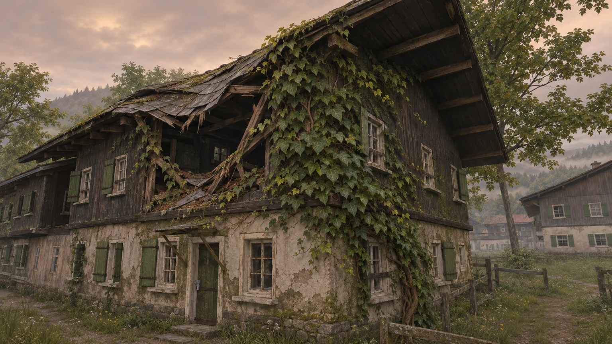

# Hof-Zielbilder für BRACHLAND

Der Hof im Œntal zeigt 40–60 Jahre nach dem Kollaps drei Zustände auf engem Raum: ein eingestürztes Haus, ein verlassenes Haus mit intakter Silhouette und, wo Bewohner verortet sind, geflickte Bauten. Das Mauerwerk aus Feldstein und Kalkputz, das hölzerne Obergeschoss und das flache Satteldach geben dem Ort seine Inntaler Identität. [Story-Bibel](design/BRACHLAND_Story-Bibel_v1.md) · [Bauwelt](design/BRACHLAND_Bauwelt_v1.md)

## Gesichtet am 18.11.2026

| Referenz | Im Bild beobachtet | Ziel für den Hof |
|---|---|---|
| **S.T.A.L.K.E.R. 2, World & Locations** | Ein Haus mit erhaltenem Satteldach steht neben einem Bau mit offenem Dachstuhl. Warmes Seitenlicht fällt auf Bruchkanten und einen durchbrochenen Holzzaun. Ein schmaler brauner Pfad bleibt zwischen den Büschen sichtbar. | Leitmotiv für den Hof. Verfallsstufen nebeneinander lesbar machen. Vegetation wächst von Rändern und Fugen in die Gasse, Feuchte sammelt sich in Senken. [Offizieller Clip bei 1:50](https://www.youtube.com/watch?v=Z5TmiZUOosE&t=110s) · [Publisher-Spielbild zum Boden](https://shared.akamai.steamstatic.com/store_item_assets/steam/apps/1643320/6dd918e8d8fd9697b281cffa9ca3d8935f5d870d/ss_6dd918e8d8fd9697b281cffa9ca3d8935f5d870d.1920x1080.jpg) |
| **The Last of Us Part II, Hillcrest** | Bruch in der Dachsilhouette, dichter Bewuchs an Gebäudekanten und in Rissen, lesbare Lücken auf der feuchten Straße. Vordergrundlaub und dunstige Hügel geben Tiefe. | Efeu vom Sockel über die Fassade wachsen lassen. Büschel an Fugen und Rändern verdichten. Einen sichtbaren Gehstreifen lassen. [Offizielles Spielbild](https://live.staticflickr.com/65535/48797065106_7e4fa520dd_h.jpg) · [PlayStation](https://blog.playstation.com/2019/09/26/new-the-last-of-us-part-ii-gameplay-details-revealed/) |
| **Metro Exodus, ländliche Holzhausgruppe** | Verwittertes graues Holz neben dunklen Giebelöffnungen, helle Balkenkanten und hohes Gras an Resten von Zäunen. Bodendunst trennt die hinteren Gebäude. | Ausgebleichtes Holz im Licht, dunkles, gealtertes Holz unter der Traufe. Eine tragende Konstruktion bleibt im Bruch erkennbar. [Publisher-Spielbild](https://shared.akamai.steamstatic.com/store_item_assets/steam/apps/412020/ss_f0f073a59827827ab32960ae280f178b4d89732b.1920x1080.jpg) · [Galerie](https://store.steampowered.com/app/412020/Metro_Exodus/) |
| **Days Gone, ländliches Anwesen** | Graues Holzhaus und dichter Bewuchs am Sockel. Der freie Erdweg zieht durch das Bild, warmes Streiflicht und kühler Walddunst trennen die Ebenen. | Weg und Lichtrichtung als Führung. Alte Gegenstände oder Schutt an wenigen plausiblen Stellen konzentrieren. Die Verfallsstufe richtet sich nach der längeren Zeitspanne in BRACHLAND. [Publisher-Spielbild](https://shared.akamai.steamstatic.com/store_item_assets/steam/apps/1259420/ss_7b63c1b0d9bd6e3951a1358f374ecd473e0f10b0.1920x1080.jpg?t=1750947718) · [Bend Studio zur Zeitspanne](https://blog.playstation.com/2019/04/19/how-bend-studio-built-the-merciless-world-of-days-gone/) |

## 1. Einsturz und Efeu an Haus 308



**Soll im Lauf aus Spielhöhe erkennbar sein:** Der Schaden setzt sich als zusammenhängende Spur vom abgesackten Dach über die gebrochene Schalung bis unter die Öffnung fort. Licht trennt ausgefaserte Kanten vom Innenraum. Kräftige, bodengebundene Efeutriebe fassen die Ecke ein und werden nach oben unregelmäßig dünner. Das Blattwerk hat sichtbare Lücken, Giebel und Dachüberstand bleiben ablesbar.

**Abstand zu D314:** Der bestehende Bruch hat noch gleichförmige Balken, eine gestufte Bretterkante und vergleichsweise dünnen Efeu. Die größte sichtbare Änderung liegt zuerst in der Silhouette und im Materialkontrast der Bruchflächen.

## 2. Sockel, Tür und Schutt


**Soll beim Vorbeigehen erkennbar sein:** Direkt unter dem Bruch liegen das gröbste Holz und die schwersten Steine. Nach außen lösen sie sich in Ziegelscherben, Splitter, feuchte Erde und einzelne Triebe auf. Die Trittplatten bleiben in der Spur zur Tür sichtbar. Kalkputz platzt bis auf mineralische Körnung und Fugen ab. Unter Fensterbänken, an der Sockelkante und im Regenabfluss zeigen sich unterschiedliche Feuchtespuren.

**Abstand zu D314:** Der kleine Schutthaufen sitzt bereits seitlich der Tür. Im Zielbild ist seine Verbindung zur Bruchstelle über gefallenes Holz sichtbar. Mehr Materialtiefe lässt sich aus einer gemeinsamen Maske für Farbe, Rauheit und Normalen gewinnen. Die Bruchkante am Mauerwerk wird nur da als Geometrie gesetzt, wo sie aus Spielhöhe Tiefe oder Silhouette verändert.

## 3. Gasse und Verfallsstufen


**Soll beim Anlaufen erkennbar sein:** Eine zusammenhängende, begangene Mitte führt durch die Gasse. Farn, Gräser und Sträucher stehen gestaffelt am Mauerfuß und an feuchten Rändern. Jeder Bau behält eine eigene Silhouette. Dachbruch, Moosdach und geflicktes Holz zeigen Unterschiede im Zustand. Pflegezeichen wie Rauch oder frischere Bretter setzen eine tatsächliche Bewohnung voraus. Warmes Streiflicht hebt vereinzelte Kanten, und der Dunst trennt die hinteren Häuser.

**Abstand zu D314:** Der Spielstand hat viele gleichmäßig niedrige Halme und relativ glatte Ränder. Mehr Wirkung entsteht durch wenige dichte Gruppen, ausgefranste Wegränder und hellere Abstufungen in der Ferne.

## Kameras für den Vergleich

Alle Angaben folgen `kamera=x,y,z,zielX,zielY,zielZ&fov=60`. Der beste Rückvergleich nutzt zuerst dieselben Ansichten mit `stimmung=zielbild` und anschliessend die Bewegung. Das Konzeptbild für den Sockel ist bewusst etwas tiefer eingerahmt, damit die Trittplatten ganz im Bild liegen.

| Bild | Spielaufnahme | Kamera und Ziel im Ausgangsbild |
|---|---|---|
| 1 | `hauslauf.mjs <name> 1 fahrt ruine`, Bild 064 | `1428.529,36.400,403.898,1426.084,37.884,409.300` |
| 2 | dasselbe Profil, Bild 183 | `1434.822,36.325,410.344,1426.240,38.040,409.300` |
| 3 | `hauslauf.mjs <name> 1 fahrt verfall`, Bild 143 | `1447,36.4,436,1457,38,432` |

Für die Umsetzung werden zuerst die Bruchsilhouette von Haus 308, dann Material und Schuttstaffelung, anschließend die Gasse verglichen. Die drei Konzeptbilder geben Motive, Materialverhalten und Licht vor. Für numerischen Bildvergleich dient ein eigener Blender-Render mit derselben Kamera nach [ADR-0006](adr/0006-zielbild-vor-zielgeraet.md). Der [Messlauf](MESSLAUF.md) prüft zusätzlich Bewegung und Bildzeiten im spielbaren Ausschnitt.

## Bildherkunft

Die drei Konzeptbilder wurden mit dem eingebauten ImageGen-Werkzeug aus eigenen BRACHLAND-Spielaufnahmen erstellt und als WebP mit 1536 × 864 Pixeln abgelegt. Die AAA-Spielbilder sind als Quellen verlinkt.

<details>
<summary>Bildprompts und verwendete Spielaufnahmen</summary>

### Zielbild 1

Eingabe `.cache/mess/d314-nach/064.png` aus der oben genannten Messkette.

```text
Use case: stylized-concept. Asset: BRACHLAND visual target, damaged alpine farm from ordinary gameplay eye height, wide landscape. Image 1 is OUR game's camera and building reference. Preserve the view angle, two-story Inn valley farmhouse, corner, dark horizontal timber beam, shallow gable, plaster base fieldstone plinth, entrance and real single connected ivy climbing around the corner. Render a grounded human-scaled rural collapse after fifty years. One roof bay has genuinely sagged and failed with irregular fractured rafters, fractured and curled gray-brown cladding, layered breaks, and an interior shadow cavity with legible depth. Rooted European ivy forms dense overlapping leaves around that corner, with stem and young growth, intermittent bare wood. Soft amber overcast sky, cool bounce under eaves, quiet mist in distance. Materials should read in the mids and one could implement it as a real-time game. Original design. Avoid any game-identifiable imagery, sci-fi, fantasy effects, fire, violence, text, UI, and excessive saturation.
```

### Zielbild 2

Eingabe `.cache/mess/d314-nach/183.png` aus der oben genannten Messkette.

```text
Use case: stylized-concept. Asset: BRACHLAND visual target of ground-level weathering and collapse debris, wide landscape. Image 1 is OUR gameplay location and framing reference for the same original Inn valley farm. Keep the existing paired entrance and window on the left half with visible pale local aggregate plaster, wood framing upstairs and broken roof silhouettes. Lower the aim a little to show the entire doorstep and rubble fan. Fifty years after collapse. From the damaged bay a connected pile of layered roof tiles, fallen gray wood and irregular limestone rubble decreases gradually into small scattered chips, damp soil and weeds. Keep two visibly clear door stepping stones next to the debris. Local damp stains at stone base, eroded lime plaster with exposed mortar, wet wood below eaves, dry silver faces in soft warm afternoon. Windows recessed with a dull dark interior. Modest lived-in architecture, natural seasonal grass, weathered muted tones, a credible realtime game framing. Original design. No UI, characters, fireworks, text, or brands.
```

### Zielbild 3

Eingabe `.cache/mess/d312-nach/143.png` aus der oben genannten Messkette.

```text
Use case: stylized-concept. Asset: BRACHLAND visual target, approach through a reclaimed Inn valley farm lane, wide landscape, game camera about two meters high. Image 1 is OUR game composition and architecture reference. Preserve rows of two-story alpine farmhouses with plaster ground floor, wooden upper floors, broad shallow dark gabled roofs, tree-lined depth, and route into the middle distance. Set it fifty years after collapse under soft hazy golden daylight. Show visibly distinct fates: one near ruined bay with missing rafters and a dark roof hole, one abandoned intact mossy roof where shrubs colonize a wet edge, a distant discreet repaired inhabited building with patched timber and small hints of maintained ground. Groundcover grows from verges, wall toes and old drainage, in uneven clumps of ivy, ferns, saplings and tall grasses among broken verge edges. Keep a readable continuous band of foot-worn gravel along the middle and clear access patches. Restrained muted greens, weathered gray wood, pale stone and subtle mountain haze; natural bounce with silhouette separation. Original design, camera remains credible at running speed, no text, no HUD, no urban skyline, no fire or fantasy glow.
```

</details>

## Spielbare Fassung von Haus 308 (D317)

`node tools/mess/hauslauf.mjs <name> 1 fahrt hofziel` erfasst die Hausruine aus denselben Kamerapositionen wie D316. Mit Probe `0` läuft der D316-Vergleich. Bild 064 ist der direkte Rückvergleich zum Konzept oben. Die neue Spielvariante nutzt `hofziel=1` und die separate Lichtstimmung `stimmung=hofziel`.

Der Vergleich liegt lokal unter `.cache/bilder/d317-hof-zielbild/index.html`. Die acht Sekunden Fahrt verwenden 192 Bilder pro Fassung bei 24 Bildern pro Sekunde. Die geladene Haus- und Gartengeometrie steigt von 406.999 auf 411.781 Dreiecke. Der Dachüberstand, die Tiefe des Bruchs und die Dichte des Efeus weichen im Spiel noch vom Konzeptbild ab.

Vier separate 12-s-Spielmessungen am M1 bei 960 × 540 und gleicher Beleuchtung (`stimmung=hofziel`) schalten am Startpunkt 1436/398/171 nur `hofziel` in der Reihenfolge 0/1/1/0 um. Im Mittel ergeben sich 45,68 → 46,00 FPS und 33,65 → 33,70 ms p95. Die längsten Einzelbilder liegen bei 50,9 ms ohne und 67,8 ms mit Probe. In beiden neuen Läufen trat je ein Bild über 50 ms auf, in den beiden Gegenläufen zusammen eines. Die Stichprobe reicht für die Einordnung des stabilen Bildzeitniveaus im Ausschnitt, größere Einzelspitzen bleiben messbar. Rohberichte unter `.cache/mess/d317-fps-{1,2,3,4}`.

Die vier Karten für Kalkputz, Schalung, Schindeldach und Feldsteinsockel wurden mit ImageGen aus dem obigen eigenen Zielbild als vier Quadranten erzeugt, zugeschnitten und mit umlaufenden Filtrierungsrändern in einen WebP-Atlas gepackt. Die Normalenkarte leitet ihr Relief aus Helligkeitsgradienten ab. Beide Atlanten sind 1280 × 1280 Pixel groß.

<details>
<summary>Prompt für die Materialkarten</summary>

```text
Use case: stylized-concept. Make a new 1:1 square texture swatch image divided exactly into four equal square quadrants that touch with no separators or borders. It will be cropped at the halfway lines to make four PBR base color maps for BRACHLAND's own original farmhouse. The supplied BRACHLAND rendering is our material reference only. Extract the same authentic hues and material meaning at the same human scale. Top-left quadrant: pale lightly warm beige lime render with flat peeling areas and exposed grey-brown stone aggregate, a fine small network of cracks, mineral colors, with fissures no bigger than a few centimeters. Top-right quadrant: very old faded gray-brown timber plank cladding, boards aligned strictly vertical in the image, irregular shallow scratches, dark thin seams, gray wood fibers, rough dryness, no visible moss and no large damage holes. Bottom-left quadrant: irregular weathered grey wooden roof shingles aligned in horizontal rows, some silver tones and warm grey, touches of thin brown-green moss in the seams, natural aged roof. Bottom-right quadrant: small dark charcoal-brown fieldstones with brown mortar and fine gray textures, scattered muted moss. Every quadrant is a flat evenly lit, orthographic seamless PBR base color texture crop, no scene perspective, no shadows, no depth of field, no light gradients, no vignettes. No architecture objects, windows or trims. No text, no graphic layout, no frame or gutters. Four equally sized fully filled materials. Heavy physical realism at ground level, muted natural colors.
```

</details>

## Dachbruch und Efeu (D318)

`node tools/mess/hauslauf.mjs <name> 1 fahrt hofdachbruch` nutzt dieselbe Kamerafahrt wie D317. Probe `0` ruft D317 auf. D318 ergänzt an Haus 308 die abgesackte, weit in die Öffnung ragende Schindelhaut, übereinander verkeilte Holzstücke, einen tiefer liegenden Innenraum, dichteren Efeu und den bemoosten Sockel. Die Variante verwendet die D317-Materialkarten bei wärmerem Himmelslicht. Eingang und Trittplatten bleiben frei.

Der lokale Vergleich unter `.cache/bilder/d318-hof-dachbruch/index.html` zeigt Zielbild, D317 und D318 nebeneinander. Beide Spielaufnahmen nutzen 192 Bilder über acht Sekunden. Die geladenen Haus- und Gartenpuffer steigen von 411.781 auf 422.536 Dreiecke. Der Spielrender behält die ursprünglichen Hausgrundrisse und weicht durch die Dachform und die Himmelsbeleuchtung sichtbar von der Vorlage ab.

Ein Raster aus 96 × 54 Sichtstrahlen an Kamera 064 trifft am isolierten Haus 308 in D317 bei 290 von 2.322 Haustrefferpunkten auf Efeublätter. In D318 sind es 422 von 2.391. Der Anteil steigt von 12,5 auf 17,6 %. Die Messung nutzt das originale Höhenfeld und betrachtet die Geometrie ohne vorstehende Geländeobjekte.

Vier getrennte 12-s-Spielmessungen am M1 bei 960 × 540, Startpunkt 1436/398/171 und identischer Beleuchtung (`stimmung=hofdachbruch`) schalten nur `hofdachbruch` in der Reihenfolge 0/1/1/0 um. Die Mittelwerte betragen 47,04 → 46,79 FPS und 33,4 → 33,6 ms p95. Längstes Einzelbild 35,3 → 50,6 ms. In der neuen Fassung gab es über beide Läufe ein Bild über 50 ms. Rohberichte unter `.cache/mess/d318-fps-{1,2,3,4}`.

## Hoflicht aus der Blender-Probe (D319)

Die Blender-Probe vergleicht auf dem D318-Mesh und mit Kamera 064 hartes Sonnenlicht, breitere Schatten und eine zusätzliche flächige Aufhellung. Die Spielvariante nähert die Aufhellung über die Oberflächenausrichtung im Hausshader an. Helligkeit und warme Tönung konzentrieren sich an Holz, Traufe und Efeu von Haus 308. Der Filterradius derselben Sonnen-Schattenkarte blendet zwischen 44 und 65 m Hofabstand des Spielers zurück.

`node tools/mess/hauslauf.mjs <name> 1 fahrt hoflicht` zeichnet die neue Fassung auf. Probe `0` läuft mit derselben Kamera, Stimmung und Geometrie wie D318. Der Rückschalter lautet `hoflicht=0`.

Der lokale Vergleich unter `.cache/bilder/d319-hoflicht/index.html` zeigt acht Sekunden Bewegung in beiden Fassungen. Die 20 geladenen Haus-/Gartenpuffer stimmen in Größe und Dreieckszahl überein (422.536 Dreiecke). Im gewählten 100 × 58 Pixel großen Ausschnitt der rechten Traufe (x=846, y=72 in Bild 064) steigt die mittlere lineare sRGB-Leuchtdichte von 0,00925 auf 0,01233.

Vier 12-s-Spielmessungen auf dem M1 bei 960 × 540 und Startpunkt 1436/398/171 schalten nur `hoflicht` in der Reihenfolge 0/1/1/0. Im Mittel 46,77 → 47,40 FPS, p95 über alle Läufe 33,4–33,5 ms. Längstes Einzelbild 51,7 → 49,9 ms. Die Unterschiede liegen im Bereich der Schwankung zwischen den Läufen. Rohberichte unter `.cache/mess/d319-fps-{1,2,3,4}`.

## Ausarbeitung am Zielbild (D320)

Haus 308 erhält eine asymmetrische Bruchkante mit überlappenden Schindeln und ausgefaserten Sparren. An der Ecke liegen mehr Efeublätter in mehreren Tiefen. Feuchtes Mauerwerk, abgeblätterte Fensterfarbe, dunkle Erde und ein verwitterter Gartenzaun verbinden die Ruine mit dem Vorfeld. Die Trittplatten und der Türquerschnitt bleiben frei.

`node tools/mess/hauslauf.mjs <name> 1 fahrt zieltreue` erfasst dieselbe 8-s-Kamerafahrt wie D319. Mit Probe `0` läuft D319. Die Bildwirkung wird in der Zielkamera 064 und beim Vorbeigehen geprüft.

Die Fahrten unter `.cache/mess/d319-nach` und `.cache/mess/d320-nach` enthalten je 192 Bilder in 1280 × 720 bei 60° Blickfeld. Der Vergleich unter `.cache/bilder/d320-zielbild-hof/index.html` zeigt Zielbild, Kamera 064 und beide Fassungen in Bewegung. Die 20 geladenen Haus- und Gartenpuffer steigen von 422.536 auf 428.291 Dreiecke (+1,36 %). Die Integrationstests prüfen unveränderte Puffer der Vergleichshäuser, verlustfreie Kompaktierung und gleichen freien Türquerschnitt. In der Spielaufnahme bleiben die Platten sichtbar. Dachprofil, Efeuverteilung und der Baumbestand am Horizont weichen weiterhin von der Vorlage ab.

Vier getrennte 12-s-Spielmessungen auf dem M1 bei 960 × 540 und Startpunkt 1436/398/171 schalten `zieltreue` in der Reihenfolge 0/1/1/0 um. Mittlere FPS 46,75 → 45,60 und mittlere p95-Bildzeit 33,45 → 33,65 ms. In den beiden neuen Läufen dauerte je ein Einzelbild 50,8 bzw. 51,7 ms. In den beiden bisherigen Läufen war das längste Einzelbild 35,3 ms. Keine Browserfehler in den vier Läufen. Rohdaten unter `.cache/mess/d320-fps-{1,2,3,4}`.

Die Blattfarbkarte `public/material/hof-efeu-farbe.webp` stammt aus dem eingebauten ImageGen. Sie wurde auf 512 × 512 Pixel verkleinert und als WebP gespeichert. Adern und Pigmente liegen in der Farbkarte, die gelappte Kontur und die Überlappung entstehen im bestehenden Hauspuffer.

Das Wolkenpanorama `public/material/hof-himmel-farbe.webp` stammt aus demselben Verfahren. Der Himmelshader legt es auf die vorhandene Kuppel und blendet es am Nebelband sowie an der Panoramanaht aus.

<details>
<summary>Prompt der Wolkenkarte</summary>

```text
Use case: photorealistic-natural. Generate a wide 2:1 equirectangular sky-dome color texture for the original BRACHLAND ruin scene. Use the supplied BRACHLAND image only as the color and cloud appearance reference, specifically the upper left sky, with realistic layered peach-gray low clouds as at a late overcast alpine afternoon. Render sky only over the entire image, a coherent 360-degree panorama with luminance and softness varied across the frame but left and right edges able to meet. The equator at center height is warm muted distant haze blending upwards into layered darker grey-peach cloud banks and small warm luminous openings between layers. Preserve readable medium-scale, finely textured cloud billows like the reference, no visible sun disk or light shafts. No ground, landscape, architecture, trees, silhouettes, water, frame, seams, labels, or text. Soft amber cloud breaks, pale air, natural low-contrast photographic style. Every pixel sky.
```

</details>

<details>
<summary>Prompt der Blattfarbkarte</summary>

```text
Use case: photorealistic-natural. Create one square diffuse-only texture for a real-time European ivy (Hedera helix) leaf mesh for the original BRACHLAND farmhouse. The supplied original BRACHLAND concept is a color and material reference. Crop face-on very closely to an ivy blade, so the deep muted olive leaf epidermis fills every single pixel of the square, extending past all four borders. The mesh already supplies the lobed silhouette. Photograph texture reading with fine understated silver pale-green branching veins, tiny scuffs and subtle mottled olive greens, muted organic hue. Stalk junction centered horizontally near bottom, a narrow central pale vein runs up the center, side veins branch upward and out at natural angles. Uniform flat diffuse illumination, subtle nonuniform leaf pigments, no brightness gradient, tactile fine botanical details. No backdrop, no vignette, no specimen border, no shadow, no other leaves, no petiole outside the blade, no text, no high-gloss highlights.
```

</details>

## Verlauf des Verfalls (D321)

Die Dachhaut hängt über einem größeren Bereich durch. An den Rändern leiten erhaltene, verschobene und ausgebrochene Schindeln in den offenen Dachstuhl über. Ausgefaserte Bretter und der unterbrochene Fassadenriegel treffen auf eine ausgebrochene Putzkante. Feuchte folgt am Holz, Putz und den Einfassungen denselben Niederschlagsspuren. An Abplatzungen kommt die Bruchsteinfarbe und -normale des vorhandenen Sockels zum Vorschein. Kleinere Blätter auf auslaufenden Trieben und fleckiges Moos verbinden Bewuchs und Mauerfuß mit der Erde.

`node tools/mess/hauslauf.mjs <name> 1 fahrt verfallverlauf` nimmt dieselbe 8-s-Fahrt wie D320 auf. Probe `0` zeigt D320. Die Hausgrundrisse, Trittplatten und Höhe und Tiefe des Türquerschnitts bleiben erhalten.

In der 60°-Kamerafahrt unter `.cache/bilder/d321-verfallverlauf/index.html` ist der Bruch am Riegel und der obere Putzrand in Bild 127 am deutlichsten zu sehen. Je 192 Bilder in 1280 × 720, ohne Browserfehler. Die Zahl der Dreiecke in den 20 geladenen Haus- und Gartenpuffern sinkt von 428.291 auf 427.566. Auf dem Prüfhang reichen vier horizontale Strahlen im oberen Bruchfeld in D320 zwischen 0,72 und 0,93 m und in D321 zwischen 0,53 und 3,80 m in das Haus. Beide Trittplatten und die vier Türstrahltiefen bleiben in der Integrationsprobe gleich. Die gestaffelte Bruchkante bleibt in der Bewegung sichtbar. Verlauf der Dachlinie und Dichte des Bewuchses weichen vom Zielbild ab.

Vier 12-s-Spielmessungen auf dem M1 bei 960 × 540 und Startpunkt 1436/398/171 schalten nur `verfallverlauf` in der Reihenfolge 0/1/1/0 um. Mittlere FPS 45,36 → 45,48. Mittlere p95-Bildzeit 33,50 → 33,50 ms, längstes Einzelbild 152,0 → 50,1 ms. Bilder über 50 ms in je zwei Läufen 3 → 1. Rohberichte unter `.cache/mess/d321-fps-{1,2,3,4}`.

## Alterung in Hof und Wohnstrasse (D322)

Haus 308 bekommt eine breitere Dachsenke, mattere Blattpigmente und Efeutriebe, die sich an der Traufe weiter ausbreiten. Erdpfade verbinden den Eingang mit dem Vorfeld. Kies liegt in Nestern und die Horste variieren in Höhe, Farbe und Abstand. Die Pfadkontur liegt im vorhandenen Grasraster und wird mit denselben Parametern auf dem Boden gezeichnet. Die zwei Trittplatten und deren Zugangsmaske bleiben frei.

Im erweiterten Ausschnitt wählt der Generator Feuchte, Abnutzung und Dachschaden aus Nutzung, Spannweite, Hanglage und ortsfestem Seed. Materialalterung läuft je Fassade unterschiedlich weit. Satteldächer geeigneter ungepflegter Häuser erhalten eine örtliche Dachsenke mit Schindelresten. Der Referenzbruch von Haus 308 bleibt die eigene Einzelfassung. Das genauere Fassadenbild realer Gebäude hängt weiterhin an A-20. Die Gebäuderegel erzeugt keine Texturdateien und verwendet das bestehende, kompaktierbare Zustandsattribut.

`node tools/mess/hauslauf.mjs <name> 1 fahrt ortsalterung` nutzt D321-Kamera und -Licht. `ortsstrasse` folgt der Wohnstraße südöstlich des Hofes mit den Häusern 316, 343 und Garage 355 außerhalb der früheren Auswahl. Probe `0` zeigt D321. Beide Fahrten haben je 192 Bilder bei 24 Bildern pro Sekunde und 60° Blickfeld.

Der lokale Vergleich `.cache/bilder/d322-hof-und-strasse/index.html` zeigt beide Fahrten parallel. In der Hofaufnahme steigen die geladenen Haus- und Gartendreiecke von 427.566 auf 444.366. An der Wohnstraße steigen sie von 404.418 auf 421.218. Die Vergleichsläufe meldeten keine Browserfehler. Der Prüfhang bestätigt unterschiedliche Alterungswerte und geänderte Dachgeometrie in der zweiten Straße. Das außerhalb liegende Gebäude 693 bleibt bytegleich. An 1.496 geprüften Punkten der vorher freigehaltenen Zugänge bleibt die Grasmaske null. Am Hofstart 1425/403 sinkt die Zahl der Nahgräser von 836 auf 797.

Vier 12-s-Spielmessungen auf dem M1 bei 960 × 540 und Startpunkt 1436/398/171 schalten nur `ortsalterung` in der Reihenfolge 0/1/1/0 um. Mittlere FPS 39,89 → 39,25. Mittlere p95-Bildzeit 34,95 → 34,95 ms, längstes Einzelbild 51,9 → 83,3 ms. Bilder über 50 ms in je zwei Läufen 1 → 4. Rohberichte unter `.cache/mess/d322-fps-final-{1,2,3,4}`.

## Dach, Baumkulisse und Weststrasse (D323)

Die abgesackte Seite von Haus 308 läuft in herabhängende Schindelenden aus. Der Giebel tritt an der Ecke zurück. An der gemeinsamen Fuge enden Dachhaut, Ortgang und Rinnen von 346 am selben, gekürzten Anschluss. In fünf Zeugenpixeln traf der erste Sichtstrahl vorher auf den überlappenden Dachteil von 346 und in D323 auf andere Geometrie oder ins Freie. Die gegenüberliegende Rinnenstrecke bleibt erhalten. Beide Trittplatten und die Türstrahlen stimmen überein. Der Geometrievergleich ändert nur 308 und 346.

Die Baumkulisse nutzt dieselben Baumstandorte. Am Giebel haben die Eichen tiefer ansetzende und breitere Kronen in gedämpfterem Oliv. Eine vorhandene Fichte im Hintergrund füllt den Saum hinter der anderen Dachseite. Vier geprüfte Eichenvarianten behalten je 10.640 Blatt- und 3.166 Astdreiecke. In der Szenenverteilung bleiben 71.328 Baumpositionen erhalten. Rendering und Kollision beziehen die Bäume weiterhin aus derselben Propquelle.

Die Weststraße (Weg 600) führt 47,19 m an den freistehenden Satteldachhäusern 508, 510 und 512 vorbei. Damit prüft sie die D322-Regeln an anderen Häusern außerhalb des ursprünglichen Hofverbunds. Die Kamera bleibt 1,63–1,91 m über dem Gelände. In der realen Geometrieprobe ändern sich die Dreiecke von Haus 508 von 1.162 auf 1.006 und bei 512 von 1.286 auf 1.800. 510 behält seine 702 Dreiecke bei geändertem Materialzustand. Das Kontrollhaus 506 bleibt bytegleich.

`node tools/mess/hauslauf.mjs <name> 0|1 fahrt hofsilhouette` nutzt die bisherige Hofkamera. `weststrasse` prüft nur den Alterungsschalter `ortsalterung`. Beide Bildfolgen haben 192 Bilder bei 60° Blickfeld. Der lokale Vergleich liegt in `.cache/bilder/d323-hof-und-west/index.html`.

Alle Aufnahmen melden null Browserfehler. Die geladenen Haus- und Gartenpuffer der Hofaufnahme enthalten 444.366 → 444.720 Dreiecke. An der Weststraße enthält die Fassung mit Verwitterung 432.116 statt 415.316 Haus- und Gartendreiecke. Die Hofbilder zeigen die abgeschattete Traufe und die neue Baumstaffelung. Die Eichenkrone bleibt gegenüber dem Zielbild offener.

Zwei CPU-Profile auf dem unveränderten D322-Build hängen beim Spielerstart 1436/398/171 in je einem ungefähr 67-ms-Bild 32,6 bzw. 34,8 ms in `waehleProps`. Beim ersten Tastendruck fällt außerdem Arbeit im WebAudio-Graph für den Lagerton an. In den erfassten langen Bildern liegen keine WebGL-Pufferuploads ab 256 KiB. Weitere Spitzen enthalten Browserarbeit oder Ladevorgänge ohne gleich eindeutige Zuordnung. CPU-Sampling erfasst die Arbeit des Hauptthreads, die gesonderten Spielläufe messen Bildzeiten ohne Sampling.

`bildruhe=1` merkt sich Nahkandidaten und Fernzuordnung bis der Fernanker, die Quelldaten oder die Sichtweite wechseln. Nah- und Mittelstufe werden weiter mit der aktuellen Kamera gewählt. Der Klanggraph entsteht nach der Eingabefreigabe erst in Hörweite eines Lagers im Leerlauf. `bildruhe=0` führt die bisherige Auswahl und Toninitialisierung aus.

Im Gegenprofil mit `bildruhe=1` bei derselben D322-Kulisse tauchen die beiden beobachteten Muster im Laufabschnitt nicht auf. Der beobachtete Aufbau der fünf Gain-Knoten fällt am Startpunkt ohne hörbares Lager weg. Ein 50-ms-Bild mit Lade- und Renderarbeit bleibt. Die lange Browserphase vor der Eingabe bleibt ebenfalls, ohne eindeutig eigenen Verursacher im CPU-Profil. Rohberichte `.cache/mess/d323-cpu-d322-{a,b}` und `.cache/mess/d323-cpu-bildruhe`.

Vier 12-s-Spielmessungen auf dem M1 bei 960 × 540 und Startpunkt 1436/398/171 bei gleichbleibender D323-Kulisse schalten nur `bildruhe` in der Reihenfolge 0/1/1/0 um. Mittlere FPS 34,93 → 32,50. Mittlere p95-Bildzeit 34,75 → 42,15 ms, längstes Einzelbild 100,1 → 52,0 ms. Bilder über 50 ms in je zwei Läufen 6 → 13. Rohberichte unter `.cache/mess/d323-fps-{1,2,3,4}`.

## Bildzeiten bei gleicher Hofkulisse (D324)

Beide Seiten verwenden die D323-Dächer, -Baumkulisse und -Beleuchtung mit `hofsilhouette=1&bildruhe=1`. Im CPU-Profil mit dieser Kulisse fiel rund 1,4 s nach dem Loslaufen ein 50,3-ms-Bild mit fünf Anfragen für Blender-Nahbaumvarianten, Pufferaufbau und Szenenarbeit zusammen. Die Spielmessung erfasst die Bildzeit gesondert. Der Grasteppich schickte je Ring das volle Raster in den Shader, einschließlich der Halme hinter der Kamera.

`bildtakt=1` zeichnet das vorhandene Raster in rund 8 m großen Instanzkacheln. Die Hüllkugeln berücksichtigen die aus der Feldtextur interpolierten Bodentiefen und den maximalen Halmüberstand durch Wind. Der Renderer kann ganze Kacheln außerhalb des Sichtfelds auslassen. Die Halmzellen, der Shader und die Maske der Trittplatten bleiben gleich. Auf der Spielroute liegen zum Start rund 0,61 Mio. weniger Dreiecke an, verteilt auf 167 zusätzliche Aufrufe. Der Foto-Grasmodus verwendet weiterhin seine ursprüngliche Geometrie. Die Nahbaumvarianten werden zusammen mit den bereits vorbereiteten Prop-Modellen vorgeladen. `bildtakt=0` stellt den D323-Pfad wieder her.

Die erste 0/1/1/0-Gegenprobe für die Kachelung allein stieg von 37,22 auf 40,75 FPS. Die Summe über 50 ms sank von vier auf zwei. In beiden Kachelläufen blieb je ein Bild mit rund 67 ms. Rohdaten unter `.cache/mess/d324-kacheln-{a1,b1,b2,a2}`.

Die abschließende 0/1/1/0-Reihe vergleicht dieselbe Kulisse auf dem M1 bei 960 × 540. Der spielbare Lauf startet bei 1436/398/171 mit 15 s Aufwärmen und 12 s Shift+W. A steht für D323, B für Kacheln plus Vorladen. Jedes erfasste Bild bleibt im Messwert.

| Lauf | FPS | Median in ms | p95 in ms | Maximum in ms | Bilder über 50 ms |
|---|---:|---:|---:|---:|---:|
| A1 | 37,65 | 31,9 | 35,1 | 35,4 | 0 |
| B1 | 40,34 | 18,6 | 35,0 | 50,0 | 0 |
| B2 | 41,18 | 18,5 | 35,1 | 35,4 | 0 |
| A2 | 37,98 | 31,7 | 35,2 | 51,9 | 2 |

D324 liegt bei 40,76 FPS und 35,05 ms mittlerem p95. Die historische D323-Serie mit Bildruhe lag bei 32,50 FPS und 42,15 ms, mit 13 Bildern über 50 ms und einer Spitze von 52,0 ms. Die aktuelle D323-Kontrolle erreicht bereits 35,15 ms p95. Die isolierte Verbesserung liegt vor allem in FPS, Median und der Zahl der langen Bilder dieser Stichprobe. Rohdaten inklusive Tastengrenzen und aller Bildzeitpunkte liegen unter `.cache/mess/d324-bildtakt-{a1,b1,b2,a2}`.

Das CPU-Gegenprofil erfasst während der Fahrt keine neuen GLB-Anfragen. Beide Profile zeigen eine lange Browserphase unmittelbar zu Beginn ihrer Aufzeichnung. Die Laufwerte in der Tabelle stammen aus den separaten Durchgängen ohne Sampling. Profile unter `.cache/mess/d324-cpu-{vor,nach}`.

Die Echtzeitaufnahmen `.cache/mess/d324-fahrt-{vor,nach}` zeigen den Lauf aus normaler Spielperspektive. `echtzeitfahrt.mjs` schneidet mit den Zeitmarken des Tastendrucks. Browserbilder behalten ihre Standzeiten im 60-Hz-Ausgabevideo. Die Aufnahmen enthalten 347 und 367 CDP-Bilder in je 12,02 s. Die Aufnahme hat eigene Last. Der direkte Bewegungsvergleich liegt unter `.cache/bilder/d324-bildzeit/index.html`.

Auf der unveränderten D323-Route erreicht die Spielfigur nach einigen Sekunden die Fassade und bleibt dort. In den ersten fünf Sekunden nach W-down (vor dem Stehen an der Fassade) steigt die mittlere Bildrate von 37,29 auf 39,43 FPS. Die Zahl der Bilder über 50 ms in diesem Abschnitt sinkt von eins auf null.

`node tools/mess/hauslauf.mjs <name> 0|1 stand bildtakt` prüft die ganze Dachkante, die Kronen und das Vorfeld an vier identischen Kamera- und Windzuständen. Alle 20 geladenen Haus- und Gartenpuffer stimmen mit insgesamt 444.720 Dreiecken überein. In den vier Bildpaaren beträgt die mittlere absolute RGB-Abweichung höchstens 0,014 von 255. Beide Echtzeitaufnahmen und alle acht Kontrollbilder entstanden ohne Browserfehler.

## Durchgehender Lauf vom Hof zur Weststraße (D325)

Die Spielfigur geht von der östlichen Hofzufahrt bei 1451/395,5 an Haus 308 vorbei. Sie nimmt die Verbindung bei z=412 und folgt anschließend Weg 600 bis 1384,8/471. Die 12 Wegpunkte liegen in der gemeinsamen Eingabesteuerung `tools/mess/hofwestroute.mjs`. Sie hält W, lenkt über den Mauspfad und prüft anhand der Spielerposition, ob die Strecke frei bleibt. Der Wechsel zur Weststraße liegt am neunten Wegpunkt bei 1362/420. Die Kamera bleibt im Spielbetrieb.

Vier Messläufe auf dem Apple M1 bei 960 × 540 wechseln nur `bildtakt` in der Reihenfolge 0/1/1/0. Sie enthalten je 15 s Aufwärmzeit. Die Bildzeiten sind die vollständigen Abstände aufeinanderfolgender Animationsframes während der Route. p95 wird je Lauf berechnet und je Variante gemittelt. Die Bilder über 50 ms werden je Variante aus zwei Läufen addiert. Das separate Video benutzt dieselbe Wegpunktsteuerung. Die Rohberichte enthalten die Position zu jedem Bildzeitpunkt.

```sh
hof='&hofgruen=1&referenzhaus=1&hofhaeuser=1&hauskompakt=1&hoflauben=1&hofboden=1&hofgras=1&teppichspar=1&kachelpuffer=1&hofverfall=1&hofranke=1&hofruine=1&hofeinsturz=1&hofziel=1&hofdachbruch=1&hoflicht=1&stimmung=hofdachbruch&umgebung=6.4&sonne=.73&umlichtstaerke=1.2&schatten=.4&zieltreue=1&verfallverlauf=1&ortsalterung=1&hofsilhouette=1&bildruhe=1'
node tools/mess/vergleich.mjs neuer-hofwest-a "${hof}&bildtakt=0" hofwest
node tools/mess/echtzeitfahrt.mjs neuer-hofwest-film-b "${hof}&bildtakt=1" hofwest 960x540
```

Alle vier Messläufe erreichen die 12 Wegpunkte in 36,4–36,5 s und legen 152,1–152,2 m zurück. Die niedrigste mittlere horizontale Geschwindigkeit in einem Fenster von mindestens 500 ms beträgt 3,02 m/s. Die Figur bleibt auf keinem der Läufe an der Fassade stehen.

| Abschnitt | FPS D323 → D324 | p95 D323 → D324 | Bilder über 50 ms D323 → D324 | Maximum D323 → D324 |
|---|---:|---:|---:|---:|
| Gesamt | 37,59 → 40,62 | 35,15 → 35,15 ms | 26 → 29 | 218,6 → 200,0 ms |
| Hof und Übergang | 37,09 → 40,54 | 35,05 → 35,15 ms | 18 → 21 | 218,6 → 200,0 ms |
| Weststraße | 38,45 → 40,75 | 35,25 → 35,15 ms | 8 → 8 | 149,5 → 116,7 ms |

Die Steigerung der mittleren Bildrate aus D324 bestätigt sich. Die kurzen D324-Läufe an der Fassade hatten höchstens 50,0 ms erreicht. Auf der durchgehenden Route dauern die längsten Bilder in allen vier Durchgängen 183–219 ms und fallen um die achte Sekunde bei x≈1420 und z≈405,6 an. Weitere wiederkehrende lange Bilder liegen im Durchgang bei z≈412 und auf der Weststraße bei z≈441. Die Positionsaufzeichnung lokalisiert die Ausreißer. Ihre Ursache lässt sich aus der Messung der Bildzeiten allein nicht bestimmen.

Die Rohberichte liegen unter `.cache/mess/d325-hofwest-{a1,b1,b2,a2}`. Die Echtzeitaufnahmen liegen unter `.cache/mess/d325-film-{a,b}`, der Seitenvergleich unter `.cache/bilder/d325-hof-weststrasse/index.html`.

## Kachelwechsel mit getrennten Puffern (D326)

Die Spitze der 152-m-Route liegt am ersten 32-m-Kachelwechsel bei x≈1420 und z≈405,6. Im CPU-Profil belegen `mergeAttributes` und `bufferData` zusammen rund 195 ms des längsten Frames. Die WebGL-Sonde zählt 53,4 MB große Pufferuploads in diesem Frame. Gärten beziehen ihre Höhen aus der Gelände-LOD-Stufe. Ein neuer Gartenpuffer ersetzte zuvor auch die vollständige Geometrie der unveränderten Häuser in derselben 256-m-Gruppe. In den folgenden Frames kamen Shader-Kompilierungen erstmals sichtbarer, teils noch leerer Instanzgruppen hinzu.

`bildfluss=1` baut Haus- und Gartenpuffer unabhängig. Gelände-Kacheln speichern identische Eckwerte einmal und verweisen über Indizes darauf. Instanzgruppen der Nah- und Fern-Props werden ab der ersten Befüllung gezeichnet. Dazu gehört beim Baumersatz dieselbe bisherige Sichtbarkeitsentscheidung. Leere Klippengruppen werden ebenfalls ausgeblendet. Ein zusätzliches Profil erfasste bei x≈1372 einen 85,7-ms-Shaderaufruf beim Zeichnen einer solchen Gruppe mit null Instanzen. Materialien, Verfall, Dreiecke und LOD-Schwellen stammen aus dem bisherigen Bau. `bildfluss=0` gibt auf derselben Kulisse den D325-Vergleichspfad.

In einer CPU-Probe an sechs Kacheln und fünf LOD-Stufen sind nach Indexexpansion alle vier Geländeattribute und die Hüllkugeln identisch. Das Datenvolumen dieser Stichprobe sinkt von 2,32 auf 0,53 MB. Der Median für den Aufbau von zwölf Kacheln auf dem M1 fällt von 64,2 auf 12,5 ms. Die Summe der Pufferuploads ab 256 KiB sinkt im separaten Profil vor der letzten Shaderkorrektur von rund 453 auf 77 MB. Messwerkzeug `node tools/mess/cpuprofil.mjs <name> "<D325-Parameter>&bildtakt=1&bildfluss=0" 4173 dist hofwest 48`. Profile haben Eigenlast. Die A/B-Bildzeiten stammen aus gesonderten Spielläufen.

Vier 152-m-Läufe am M1 bei 960 × 540 vergleichen `bildfluss=0/1/1/0`. Alle erreichen dieselben 12 Wegpunkte. Der historische D325-Maximalwert von 200,0 ms tritt in der frischen D325-Kontrolle an derselben Stelle mit 249,9 und 252,0 ms auf. Die Spitzen der beiden D326-Läufe sind 66,7 bzw. 83,3 ms. Mit D326 bleiben in beiden Durchgängen je zwei Bilder über 50 ms am Hof und im Übergang.

| Abschnitt | FPS D325 → D326 | p95 D325 → D326 | Bilder über 50 ms D325 → D326 | Maximum D325 → D326 |
|---|---:|---:|---:|---:|
| Gesamt | 40,38 → 42,55 | 35,20 → 34,45 ms | 26 → 4 | 252,0 → 83,3 ms |
| Hof und Übergang | 39,52 → 42,17 | 35,20 → 34,60 ms | 18 → 4 | 252,0 → 83,3 ms |
| Weststraße | 41,88 → 43,21 | 35,05 → 34,25 ms | 8 → 0 | 116,7 → 50,0 ms |

Die Rohberichte liegen unter `.cache/mess/d326-hofwest-{a1,b1,b2,a2}`. Die CPU-Profile sind `.cache/mess/d326-cpu-{vor,programme,zwischenschritt,nach,rest}`. Die Aufnahmen entstehen getrennt von der Zeitmessung. Der D325-Referenzclip und die neue D326-Aufnahme laufen nebeneinander in `.cache/bilder/d326-hofruckler/index.html`.

Vier Kontrollbildpaare ohne HUD vergleichen dieselbe Kamera und Windphase über `hauslauf.mjs <name> 1 stand bildfluss` mit dem D324-Referenzsatz `.cache/mess/d324-stand-nach`. Beide Fassungen enthalten in den geladenen Haus- und Gartenpuffern exakt 444.720 Dreiecke. Die mittlere absolute RGB-Abweichung beträgt je Bild höchstens 0,014 von 255. Die Bewegungsaufnahme der korrigierten Fassung erreicht dieselben 12 Wegpunkte in 36,26 s. Messung und Aufnahmen melden keine Browserfehler.

## Gemeinsamer Kachelwechsel mit vorbereiteten Uploads (D327)

Das frische D326-Profil reproduziert den verbliebenen Hofruckler mit 82,4 ms bei x≈1420,1 und z≈405,6. Im Frame liegen rund 7 ms Gartenindizierung, mehrere Zusammenführungen von Gelände- und Haus-/Gartenpuffern und 1,735 MB Straßenattribute. Die bekannten späten Fernanker-Frames enthalten zudem Arbeit in `waehleProps` für die Fernschlüsselliste. Ein Gegenprofil mit gestaffeltem CPU-Bau allein zeigt verbleibende Uploadspitzen an der gemeinsamen Freigabe. Beim längsten dieser Frames entfallen rund 42 ms auf `bufferData`.

`kachelnachlauf=1` hält nach dem Laden die letzte vollständige Geländefassung sichtbar. Der 32-m-Anker bestimmt dieselbe stabil sortierte Kachelauswahl für Gelände und Bänder. Der Bau und die Zusammenführungen laufen schrittweise mit einer gemeinsamen 3-ms-Frist. Eine einzelne Operation darf die Frist überschreiten. Große neue GPU-Puffer werden vor ihrer Freigabe in einem separaten 1×1-Renderziel mit leerem Zeichenbereich vorbereitet. Danach wechseln Boden, Wege, Wasser, Häuser und Gärten gemeinsam. Identische Bandquellen behalten ihren Puffer und ihre Dreieckfolge. Alte Puffer werden nach dem Szenenwechsel freigegeben. Bei Sprung oder Pegelwechsel lässt sich ein laufender Auftrag ersetzen. Der Fernanker speichert seine Zuordnung als Position und bildet vollständige Fernschlüssel nur bei Bedarf. Die bisherigen Stufen, Geometrien und Materialien gelten weiter. `kachelnachlauf=0` schaltet auf den direkten Kachelwechsel zurück.

Die 152-m-Route bleibt dieselbe. Beide neuen Läufe erreichen alle 12 Wegpunkte. In einem Radius von 1 m um die drei Koordinaten der vier D326-Ausreißer liegen die längsten Frames in D327 bei 33,8 ms (Hof bei x≈1420), 34,2 ms (Übergang bei x≈1385) und 34,3 ms (Fernanker bei x≈1393). Die zwei verbliebenen langen Frames aus den D327-Läufen liegen an anderen Stellen. Es sind 66,6 ms nach 2,23 s und 50,1 ms nach 28,27 s.

| Unabhängige Spielläufe auf dem M1 bei 960 × 540 | FPS | p95 | Bilder über 50 ms | Maximum |
|---|---:|---:|---:|---:|
| D326-Messreihe aus dem vorherigen Stand, zwei Läufe | 42,55 | 34,45 ms | 4 | 83,3 ms |
| Unveränderter D326-Build aus `afd9bfc`, zwei neue Läufe | 46,45 | 33,80 ms | 4 | 99,9 ms |
| Gemeinsamer Build mit direktem Wechsel, zwei Läufe | 46,54 | 33,75 ms | 1 | 50,1 ms |
| D327 mit gestaffeltem Wechsel, zwei Läufe | 46,03 | 33,65 ms | 2 | 66,6 ms |

Im frisch gebauten D326 lagen alle vier langen Bilder am Hof bei x≈1420. Die beiden D326-Läufe erreichten 46,08 und 46,81 FPS, die D327-Läufe 45,52 und 46,54 FPS. Damit liegen die Mittelwerte rund 0,9 % auseinander und die Laufspannen überlappen. Ein zusätzlicher D327-Kontrolllauf erreichte 45,50 FPS, 34,20 ms p95 und maximal 48,7 ms.

Die Umschaltmessung läuft in der Reihenfolge 0/1/1/0. Der direkte Wechsel enthält bereits die gemeinsamen Änderungen am Kachellauf und bleibt als Gegenprobe verfügbar. Die vier Berichte liegen unter `.cache/mess/d327-hofwest-{a1,b1,b2,a2}`, die beiden CPU-Diagnosen unter `.cache/mess/d327-cpu-{vor,kandidat}`. Die frischen D326-Berichte liegen unter `.cache/mess/d327-d326-kontrolle{,-zwei}`, der zusätzliche D327-Bericht unter `.cache/mess/d327-aktuell-kontrolle`. Der Seitenvergleich verwendet die bestehende D326-Echtzeitaufnahme und die neue D327-Aufnahme der vollständigen Route. Er liegt unter `.cache/bilder/d327-hofwest-vergleich/index.html`.

Vier Kontrollbilder mit gleicher Kamera und Windphase vergleichen `.cache/mess/d326-stand-nach` mit `.cache/mess/d327-stand-nach`. Die Haus- und Gartenpuffer enthalten in beiden Fassungen 444.720 Dreiecke. Die mittlere absolute RGB-Abweichung beträgt höchstens 0,011 von 255. Die vollständige neue Aufnahme dauert 36,28 s und erreicht alle 12 Wegpunkte. Die Messungen, Bilder und Aufnahmen melden keine Browserfehler.

## Kürzere Baum- und Kachelwechsel im Hoflauf (D328)

Bei x≈1442,7 und z≈400,2 überschreitet die Kamera erstmals den 8-m-Anker der Nah-Props. Die 66,6-ms-Stelle aus D327 deckt sich mit früheren Profilen von 65,6 bis 81,5 ms und einem erneuten D327-Profil von 50,0 ms. Im neuen Profil entfallen 9,8 ms auf Kopien von BufferAttributes, 6,2 ms auf das Lesen von Vertexattributen und 2,6 ms auf Matrixanwendung. Es erscheinen weder große Pufferuploads noch neue Shaderprogramme in diesem Frame. An der Weststraße wird um x≈1371 und z≈440 die nächste Auswahl an Geländekacheln gebaut. Im neuen D327-Profil folgen auf einen 50,0-ms-Frame bei x≈1370,7 kurz darauf 66,7 ms mit 14,3 ms beim Zusammenführen von Terrainattributen. Der längere Frame enthält auch andere Render- und Spielarbeit.

Bei aktivem Kachelnachlauf halten die EZ-Baumsätze ihre Sphären vor der Kopie der LOD-Stufen bereit. Ersatz- und Wartegruppen übernehmen diese Sphären samt der bisherigen Windreserve. Verdeckt übernommene Blender-Bäume behalten ihre Instanzen und bauen das Blender-Netz erst bei einem sichtbaren Rückfall. Prop-Montagen bauen die Attrappe bei Bedarf und bestimmen ihre Hüllkugel einmal. Beim Kachelwechsel entstehen die Indizes direkt im passenden typisierten Array. Attribute und Hüllkugeln werden in Teilschritten vorbereitet, danach folgt der bestehende GPU-Vorlauf. Der Geometrietest vergleicht Indizes, Vertexattribute und Hüllkugeln direkt mit dem bisherigen Merge, auch für die 32-Bit-Indizes. `bildspitzen=0` dient als Gegenprobe.

| 152-m-Route auf dem M1 bei 960 × 540 | FPS | p95 | Bilder über 50 ms | Maximum |
|---|---:|---:|---:|---:|
| D327, vorige Laufreihe | 46,03 | 33,65 ms | 2 | 66,6 ms |
| Gemeinsamer Build, D327 mit `bildspitzen=0` | 45,88 | 34,35 ms | 2 | 81,3 ms |
| Gemeinsamer Build, D328 mit `bildspitzen=1` | 45,88 | 34,20 ms | 0 | 48,5 ms |

Je zwei Läufe ohne Videoaufnahme, in der Umschaltfolge 1/0/0/1. Alle vier Läufe erreichen alle 12 Wegpunkte nach 152,18 bis 152,30 m. Die D328-Einzelläufe erreichen 45,86 und 45,90 FPS. In 1 m Umkreis der beiden bisherigen Ausreißerstellen bleibt D328 bei höchstens 35,3 ms am Hof und 35,4 ms auf der Weststraße. Der frische D327-Gegenlauf reproduziert die Hofspitze bei x≈1442,6 und z≈400,25. Am ursprünglichen Weststraßenpunkt bleiben die frischen D327-Läufe unter 50 ms. Im CPU-Profil liegt im selben Straßenabschnitt weiterhin die Arbeit des ungeteilten Kachel-Merges. Ein zusätzlicher Lauf des unveränderten D327-Builds vor den Änderungen erreicht 43,61 FPS, p95 34,20 ms und maximal 49,9 ms an der frühen Hofstelle.

Berichte liegen unter `.cache/mess/d328-ab-{a2,a3,b1,b2}`. Der CPU-Bericht stammt aus `.cache/mess/d328-d327-cpu-a1`, der unveränderte D327-Lauf aus `.cache/mess/d328-vor-a1`. Der direkte Bewegungsvergleich der getrennten Echtzeitaufnahmen liegt in `.cache/bilder/d328-hofwest-vergleich/index.html`.

Vier Kontrollbilder unter `.cache/mess/d328-stand-{a,b}` nutzen dieselbe Kamera und Windphase. Die Haus- und Gartenpuffer umfassen in beiden Fassungen 444.720 Dreiecke. Die mittlere absolute RGB-Abweichung beträgt in jedem Paar höchstens 0,013 von 255. Beide Echtzeitaufnahmen zeigen aus normaler Spielperspektive dieselben 12 Wegpunkte in rund 36,3 s. Messungen und Aufnahmen melden keine Browserfehler.

## Drei Nutzungszustände an der Weststraße (D329)

Die Häuser 508, 510 und 512 am Wohnweg 600 bauen auf den vorhandenen OSM-Grundrissen und LoD2-Dächern auf. Der Giebel, die Hanglage und die Blickrichtung vom Wohnweg bestimmen die zugewandte Traufe und die Fassaden.

| Haus | Lesbares Merkmal in Spielhöhe | Ableitung |
|---|---|---|
| 508 | Eingesackte Traufe, freiliegende Sparren, gebrochene Scheiben und Schutt am Fuß derselben Wand | Spannweite und Hangfeuchte verstärken die Dachsenke. Die Dachkante folgt mehreren Teilabschnitten um die Bruchstelle. Wiederverwendete Schindeln und Holzquerschnitte hängen am Bruch. |
| 510 | Zusammenhängende Efeupolster vom Sockel bis zum Obergeschoss unter intakter Dachkante | Straßenfassade und kühle Seiten bestimmen Blattdichte und Ausladung. Wurzeln, Verästelung und Blattverteilung kommen aus Wandlänge, Geländehöhe und Gebäudeseed. |
| 512 | Geflicktes Blechdach, Ersatzholz, gefasste Tür und gesetzte Steine im Vorfeld | Die Tür nutzt die zum Wohnweg gewandte geeignete Wand. Ersatzblech folgt einer bestehenden Dachseite. Dünne Falze und unterschiedlich alte Bretter machen die Reparatur lesbar. |

`content/regions/oental.json` hält je Haus einen Punkt im Grundriss, einen Punkt auf dem Wohnweg und den Nutzungszustand. Diese drei Werte reichen für den Generator. Der Umschalter `westverfall=1` aktiviert die Fassungen bei aktiver Ortsalterung. Probe `0` zeigt D328. Die Details gehen in die vorhandenen Hauspuffer ein. Dieselbe Shaderlogik nutzt den vorhandenen Zustandskanal für Feuchte und Abnutzung. Die Geometrieprobe prüft die eindeutige Zuordnung, die drei Zustände, Indexierung und Fensterglut. Bei den Kontrollgebäuden stimmen die Vertexdaten byteweise.

Die dreifache Ansicht mit gleichem Licht und gleicher 55-Grad-Kamera in Spielhöhe liegt als Vorher-Nachher-Vergleich neben der normalen 152-m-Fahrt. Die Straßenansicht zeigt Bruch und Gerüst bei 508 klar an der linken Traufe. Der Efeu von 510 hat Nester aus Geometrie und eine auslaufende Grunddeckung an derselben Fassade. Bei 512 sind Türstock und geflicktes Vordach aus Spielhöhe deutlicher als das Blechfeld auf der Hauptdachfläche. In der gleich gerahmten Detailprobe wachsen die geladenen Haus- und Gartenpuffer von 432.470 auf 439.350 Dreiecke. Alle sechs Bildbelege meldeten null Browserfehler.

| Zwei Spielläufe pro Fassung auf dem M1 bei 960 × 540 | D328 | D329 |
|---|---:|---:|
| FPS, gesamte 152-m-Route | 50,44 | 50,20 |
| FPS, Weststraße | 50,87 | 51,01 |
| p95, gesamte Route | 33,40 ms | 33,40 ms |
| Längster Frame | 35,4 ms | 35,3 ms |
| Bilder über 50 ms | 0 | 0 |

Alle Läufe erreichten alle 12 Wegpunkte ohne Browserfehler. Die Messungen liefen ohne Video in der Folge `westverfall=0/1/1/0` bei aktiven D328-Optimierungen. Die Einzelberichte liegen unter `.cache/mess/d329-finale-ab-{a1,b1,b2,a2}`. Zwei separate Echtzeitaufnahmen unter `.cache/mess/d329-finale-film-{a,b}` ergeben den direkten Vergleich unter `.cache/bilder/d329-weststrasse/index.html`. Die drei abgestimmten Ansichten je Fassung liegen unter `.cache/mess/d329-finale-stand-{a,b}` und lassen sich mit `node tools/mess/hauslauf.mjs <name> <0|1> stand westverfall` wiederholen.
