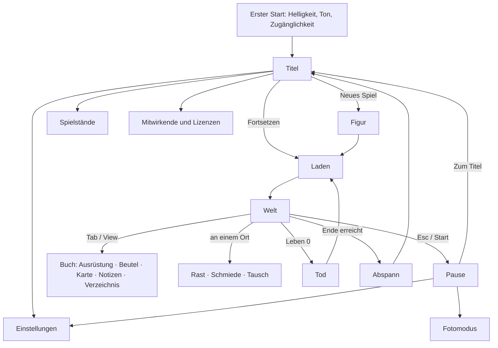

# BRACHLAND — Menü, Einstellungen und Oberflächen ausserhalb des Kampfes (v1)

> **Entwurf 22.11.2026 (D394). Reine Spezifikation, keine Oberfläche gebaut.** Auftrag Flo: „Danach bitte auch das
> Menü, Einstellungen usw. erarbeiten sowie definieren was es hier alles benötigt oder kommt das später?“
> Offen/entschieden steht im Ledger (`docs/_INDEX.md` A-29, D394), nicht hier.
> Gebaut ist nur das Schema `Einstellung` mit den 18 einfachen M-Einträgen (`content/einstellungen.json`, §6, §8.2).
> Zielgerät: Desktop-Browser, M1 als Mess-Referenz (ADR-0006/0016), WebGL heute, WebGPU als Qualitätspfad (ADR-0015).
> Handy nachrangig. Stil: gemalter Realismus (ADR-0018).

## 0. Antwort auf „jetzt oder später?“

**Beides — die Bildschirme später, fünf Fundamente jetzt.** Kein Menü muss heute gezeichnet werden. Aber fünf Dinge
legen fest, wie jeder künftige Code geschrieben wird; jede Woche ohne sie vergrössert den Umbau:

| Jetzt festlegen und bauen (ohne Oberfläche) | Warum nicht später |
|---|---|
| 1. Einstellungs-Store + Qualitätsstufen | 82 URL-Schalter werden heute beim Modulstart einmal gelesen (`src/world/echt.ts`); jeder neue Effekt kommt als weiterer Schalter dazu. Ohne Store gibt es keine Stufe „Mittel“, nur Adressen |
| 2. Eingabe als Aktionen statt Tastencodes, Gamepad lesen | Tastencodes stehen an vier Stellen im Code; D392/D393 und das Reinigen (Taste **F** vorgeschlagen, heute „Blick senken“) bringen weitere. Zwei Kollisionen gibt es schon (§1.4) |
| 3. Speicherformat mit Hülle, Version, Migration | Heute verwirft `ladeStand` jeden Stand mit anderer Version **ganz** (`src/spiel/spielstand.ts:149`). D392/D393 ändern den Stand; der erste Versionssprung löscht sonst jeden Testerstand |
| 4. Texte aus Dateien (`t('…')`) | Jeder neue Bildschirm schreibt sonst weitere deutsche Sätze in TSX. Auslagern kostet je Satz gleich viel, die Zahl der Sätze wächst |
| 5. HUD-Grundraster + Spielphasen (Titel/Laden/Welt/Pause/Tod) | Fünf Anzeigen sitzen mit festen Pixeln in `src/main.tsx`; Marke, Richtungsblock, Reinigen-Fenster und Lehrhinweise kommen dazu. „Pause“ gibt es als Zustand nicht |

Vor dem ersten Fremdtest kommen die Bildschirme, ohne die ein Fremder nicht spielen kann (Titel, Laden, Pause,
Einstellungen mit den M-Einträgen, Tod, Export). Alles Übrige vor Veröffentlichung. Phasenplan mit Aufwand: §9.

---

## 1. Bestandsaufnahme (Stand `2b80c8a`, 22.11.2026)

### 1.1 Bildschirme

| Was | Wo | Befund |
|---|---|---|
| Menü mit vier Reitern: Karte, Beutel, Team, Verzeichnis | `src/ui/Menue.tsx:37`, `:82`, Reiter ab `:176`/`:257`/`:339`/`:408`; Entscheidung D83 | Auf per Knopf oben links (44 px, fürs Handy) und `Escape` schliesst (`:96`). **Pausiert nichts.** Kopfzeile trägt zwei lose Knöpfe: „Richtung an/aus“ (`:138`) und „Figur“ (`:143`) |
| Karte | `src/ui/karte.ts`, `Menue.tsx:176` | Biomraster, Höhenlinien, Wege; zeichnet **nur Selbstgefundenes** (D83) |
| Herkunft der Modelle (Lizenzen) | `Menue.tsx:455`–`:482`, gebündelt aus `public/herkunft.json` (`:30`), erzeugt von `npm run herkunft` aus `assets/HERKUNFT.md` (D127) | Steht im Reiter Verzeichnis. Pflichtinhalt für CC-BY ist damit technisch gelöst, aber versteckt |
| Charakter-Editor | `src/ui/HeldEditor.tsx`, Aufruf `src/main.tsx:1109` | Vor dem ersten Schritt und über den Knopf „Figur“ |
| Zuflucht/Bewohner: Rasten, Aufträge, Schmiede | `src/ui/Ortsfenster.tsx:29`, Schmiede `:78`, Rasten `:112`; Raum `src/ui/Stube.tsx` | Ein Fenster, kein Dialogbaum |
| Rundenkampf-Bildschirm (Altbestand) | `src/ui/BattleScreen.tsx`, `src/main.tsx:978` | Läuft bis zum Schnitt parallel (ADR-0007) |
| Ladebildschirm | `src/main.tsx:910` | Eine Textzeile „… wird geladen …“. Keine Vorwärmung, kein Fortschritt |
| Tod / Wiedereinstieg | `src/main.tsx:482`–`:489` | Kein Bildschirm: Man wacht mit einem Hinweistext an `letzteZuflucht` auf (D179) |
| Titel, Pause, Einstellungen, Spielstände, Notizbuch, Händler, Fotomodus, Abspann | – | **Fehlen** |

### 1.2 HUD

| Teil | Wo | Dauerhaft? |
|---|---|---|
| Eigenes Leben, Ziel-Leben + Ziel-Haltung, Meldung, Ladung Kernfunke | `src/ui/Kampfanzeige.tsx:63`, `:156`, `:157`, `:29` | nur am Kampfplatz `?kampf=` |
| Ausdauer | `src/ui/Ausdaueranzeige.tsx:47` | blendet bei vollem Vorrat aus |
| Witterung (Richtung/Abstand zur nächsten Kreatur) | `src/ui/Witterung.tsx:62` | bei Nähe |
| Hinweistext, Fragment-Lesefenster, Ansprech-Knöpfe | `src/main.tsx:1283`, `:1064`, `:1144` | bei Bedarf |
| Bedienzeile „links halten = gehen · …“ | `src/main.tsx:1367` | **immer**, beschreibt die Touch-Bedienung, auch am Desktop |
| Tageszeit-Regler mit Pause-Knopf | `src/main.tsx:1000`–`:1026` | **immer** — Entwicklerwerkzeug im Spielbild |
| Messanzeige (B/s, Dreiecke, Aufrufe, Ladezeit) | `src/main.tsx:1299` | immer, sobald gemessen wird |
| Daumenknüppel (Touch) | `src/ui/Stockanzeige.tsx:74` | solange ein Finger liegt |

Es fehlen: Marke/Ladungen, eigene Haltung, Richtungsblock-Anzeige, Reinigen-Fenster („greifbar“, verlangt in
`BRACHLAND_Weg-nach-Brannburg_v1.md` Station 4), Lehrhinweise als Tastensymbol, HUD-Skalierung, „HUD aus“.
Farbbefund: Die Signalfarbe `#3fd9a0` (`src/ui/BattleScreen.tsx:28`) gehört dem Befall, färbt aber auch aktive Knöpfe und
den Tageszeit-Regler (`src/main.tsx:1009`, `:1340`).

### 1.3 Einstellungen

Es gibt **keinen Einstellungsbildschirm und keinen Einstellungs-Speicher**. Was es gibt:

- `richtungskampf` — liegt im **Spielstand** (`src/spiel/spielstand.ts:92`, dort selbst als „Spieleinstellung, kein
  Weltzustand“ bezeichnet), Knopf im Menü.
- Messmenü hinter einem Klick auf die Messanzeige (`src/main.tsx:1322`–`:1345`): Pixel 1×/1,5×/2×, Schatten, Gras aus,
  Weit. Zustand `Qualitaet` (`src/scenes/RegionsSzene.tsx:4442`, Standard `:4464`), **nicht gespeichert**.
- 82 URL-Parameter (Liste §1.5), gelesen beim Modulstart — wirken nur nach Neuladen.

### 1.4 Eingabegeräte

| Gerät | Stand | Wo |
|---|---|---|
| Tastatur, Bewegung | W A S D / Pfeile gehen, **Q/E drehen**, **R/F neigen**, Shift rennen, Leertaste springen | `src/spieler/steuerung.ts:70`–`:82` |
| Tastatur, Kampf | J leicht, I schwer, K Rolle, L Ziel, **Q/E Zielwechsel**, U Block, 1/2/3/Tab Waffe | `src/kampf/Kampfplatz.tsx:495`–`:507`, `:701` |
| Tastatur, Kamera | C Umschau, V Ansicht | `src/scenes/RegionsSzene.tsx:4180`, `:4189` |
| Maus | Ziehen = Blick (ohne Pointer Lock), Rad = Abstand, rechte Taste = Block | `steuerung.ts:173` ff., `RegionsSzene.tsx:4196`, `Kampfplatz.tsx:701` |
| Touch | zwei Ratenstöcke, Tippen rechts = springen | `steuerung.ts:228` ff. |
| **Gamepad** | **nicht vorhanden** (kein `getGamepads` im Quelltext) | – |
| Pointer Lock, Vollbild, `visibilitychange`, WebGL-Kontextverlust | **nicht vorhanden** (Suche im Quelltext ohne Treffer) | – |
| Ton-Entsperrung | vorhanden: Kontext wird bei erster Eingabe fortgesetzt | `src/ton/lagerton.ts:91`–`:95` |

Alle Tasten sind **fest im Code**, keine Belegung als Daten. Kollisionen heute: Q/E heisst in der Welt „drehen“ und im
Kampf „Zielwechsel“; die fürs Reinigen vorgeschlagene Taste **F** (`BRACHLAND_Reinigen_v1.md` §2) ist „Blick senken“.

### 1.5 Speicherstand

- IndexedDB `brachland`, Ablage `spielstand`, **ein** Schlüssel `aktuell` (`src/spiel/spielstand.ts:134`–`:136`).
- Geschrieben wird bei jeder Zustandsänderung sofort (`src/main.tsx:572`, `:605`, `:644`, `:681`), Rast setzt
  `letzteZuflucht` (`:823`).
- `SPIELSTAND_VERSION = 1` (`spielstand.ts:19`). Neue Felder wurden bisher **ohne** Versionssprung ergänzt, weil ein
  Sprung den Stand verwirft (`:149`, Begründung `:66`). Es gibt keine Migration, kein Schema zur Laufzeit (nur ein
  TypeScript-Interface), keinen Export, keine Sicherungskopie.
- `loescheStand()` (`:175`) ist nirgends verdrahtet — „Neues Spiel“ gibt es nicht.
- Schlägt IndexedDB fehl (privater Modus), spielt man ohne Stand, **ohne Meldung** (`:161`).

### 1.6 Schalter, die es nur als URL gibt

82 Parameter (`grep "get('…')"` über `src/`). Nach Zweck:

| Gruppe | Parameter | Wird Einstellung? |
|---|---|---|
| Qualität, die ein Spieler wählen würde | `echt` (Bündel), `schatten`, `schattenkarte`, `gras`, `weite`, `msaa`, `taa`, `bloom`, `schacht`, `ao`, `pom`, `laub`, `laubkarten`, `fernring`, `wasserreflex`, `umlicht`, `hdri`, `detail`, `normalmap`, `mikro` | **ja**, als Qualitätsstufe und Einzelwert (§6.1) |
| Anzeige | `belichtung`, `fov`, `zoom` | **ja** (§6.2) |
| Stil (Art Direction, entschieden) | `malerei`, `pinsel`, `kuwahara`, `kontur`, `nebel`, `stimmung`, `himmel`, `sonne`, `kurve`, `hemiboden`, `umgebung` | **nein** — bleiben Entwicklerschalter; Stil ist keine Spielerwahl |
| Baustufen des Vertikalschnitts | `hofgruen` … `milbingerfinale` (rund 50 Konstanten in `echt.ts:18`–`:131`), `bau`, `haus`, `belag`, `ufer`, `stamm`, `bett`, `weiher`, `bach`, `gewaesser`, `wellen`, `flur`, `lod2`, `streu`, `boden`, `efeukarten`, `hausfront`, `fenstertiefe` | **nein** — werden fest, sobald abgenommen; bis dahin Entwicklerschalter |
| Mess- und Testadressen | `absetzen`, `kamera`, `zeit`, `aus`, `kampf`, `galerie`, `regent`, `region`, `stube`, `held`, `zuflucht`, `lager`, `waffe`, `waffenstufe`, `funke`, `rig`, `richtung`, `spiegel`, `umschau`, `pose`, `figur`, `fuesse`, `eile`, `bewohner`, `geheilt`, `wasser`, `auftauchen`, `takram`, `felsprobe`, `ezbaum`, `ezcluster`, `ezdiagnose`, `kachelpuffer`, `teppichspar`, `grasstruktur`, `bodenkantig`, `clip`, `haut`, `t` | **nein** — Werkzeuge (`src/scenes/abschalter.ts:38` für `aus`) |
| WebGPU-Probe | `webgl`, `mrt`, `bilder`, `leer` (`src/probe/webgpuStauwehr.ts:56`) | Renderpfad wird Einstellung, sobald der Pfad das Spiel trägt. ADR-0015 nennt `?renderer=webgpu`; im Hauptspiel gibt es den Schalter nicht |

---

## 2. Recherche: 14 Regeln mit Quelle

| # | Regel für BRACHLAND | Quelle |
|---|---|---|
| R1 | **Jede Steuerung ist frei belegbar, auch Esc; Hinweise zeigen immer die aktuelle Belegung.** | Game Accessibility Guidelines (GAG), Basic/Motor: „Allow controls to be remapped / reconfigured“ — <https://gameaccessibilityguidelines.com/full-list/>; Xbox Accessibility Guidelines (XAG) 107 Input: Remapping inkl. Esc, Beschriftung folgt der Belegung — <https://learn.microsoft.com/en-us/gaming/accessibility/xbox-accessibility-guidelines/107> |
| R2 | **Alles geht mit Tastatur allein und mit Gamepad allein**, Menüs mit Einzeltasten, ohne gleichzeitiges Drücken. | XAG 107 („using a keyboard alone“, „single, non-simultaneous key presses“); GAG Basic/Motor: UI mit derselben Eingabe wie das Spiel bedienbar |
| R3 | **Kein Halten als Pflicht:** Rennen, Blocken, Klettern haben „Umschalten“; kein Tastenhämmern. | GAG Intermediate: „Avoid / provide alternatives to requiring buttons to be held down“; XAG 107 (Toggles, keine QTEs) |
| R4 | **Empfindlichkeit einstellbar** (Maus, Stick), mindestens ±50 % um den Standard; Achsen einzeln umkehrbar. | XAG 107; GAG Basic/Motor |
| R5 | **Keine wesentliche Information nur über Farbe.** Befall ist Farbe **und** Form (Pilzfächer, Puls) **und** Symbol im HUD. | GAG Basic/Vision: „Ensure no essential information is conveyed by a fixed colour alone“ |
| R6 | **Text gross genug ab Werk, hoher Kontrast zum Grund, skalierbar.** | GAG Basic/Vision (Schriftgrösse, Kontrast); XAG 101 Text display, XAG 102 Contrast — <https://learn.microsoft.com/en-us/gaming/accessibility/guidelines> |
| R7 | **Untertitel für alle wichtige Sprache, an ab Werk, mit Grösse, Hintergrund und Sprechername; wichtige Geräusche auch sichtbar.** | GAG Basic/Hearing; GAG Intermediate „Allow subtitle/caption presentation to be customised“; XAG 104 |
| R8 | **Getrennte Lautstärken** für Effekte, Sprache, Musik/Umgebung. | GAG Basic/Hearing |
| R9 | **Kamerawackeln, Bewegungsunschärfe, Blitzen abschaltbar; Sichtfeld einstellbar.** | XAG 117 Visual distractions and motion; GAG Basic/Cognitive „Avoid flickering images“; GAG Intermediate (Sichtfeld) |
| R10 | **Alle Einstellungen werden gemerkt; Einstellungen sind vor Spielbeginn und im Spiel erreichbar; das Spiel startet ohne Menü-Marathon.** | GAG Basic/General „Ensure that all settings are saved/remembered“; GAG Basic/Cognitive „Allow the game to be started without the need to navigate through multiple levels of menus“ |
| R11 | **Hilfen statt Schwierigkeitsgrade, einzeln schaltbar, ohne Strafe.** Gelobt: Hades „God Mode“ (20 % Schadenswiderstand, +2 % je Tod bis 80 %, sperrt nichts), Dead Cells „Assist Mode“ (Schaden, Parierfenster u. a. einzeln), The Last of Us Part II (über 60 Optionen, Voreinstellungen je Bedarf, Hochkontrast), God of War Ragnarök (über 70, Voreinstellungen „etwas/voll“). Lies of P reichte Schwierigkeitsstufen später nach. | Hades: <https://www.gamesradar.com/hades-god-mode-achievements>, <https://inverse.com/gaming/hades-god-mode-interview>; Dead Cells: <https://www.pcgamer.com/dead-cells-is-getting-accessibility-features-including-an-assist-mode>; TLOU2: <https://www.playstation.com/en-us/games/the-last-of-us-part-ii/accessibility/> (Herstellerangabe); Ragnarök: <https://www.playstation.com/en-us/games/god-of-war-ragnarok/accessibility/> (Herstellerangabe); Lies of P: <https://www.videogameschronicle.com/news/lies-of-p-is-getting-difficulty-options-to-make-the-soulslike-more-accessible>; GAG Intermediate „Include assist modes“; XAG 108 |
| R12 | **Was Elden Ring falsch macht, nicht wiederholen:** Menü pausiert nicht (Pause nur über einen versteckten Umweg); Tastensymbole zeigen ab Werk das Gamepad, die Umstellung liegt im falschen Menü; zwei Tasten nicht belegbar; Esc geht nicht überall zurück; Menüs nicht für Maus gebaut. | <https://www.pcgamer.com/elden-ring-pc-keyboard-mouse-controls/>, <https://gamerant.com/elden-ring-no-pause-option-rumor/>, <https://kotaku.com/elden-ring-ui-ux-user-experience-interface-fromsoftware-1848637410> |
| R13 | **Browser nimmt sich Rechte, das Spiel muss damit rechnen:** Esc beendet Pointer Lock und Vollbild immer — das **ist** die Pause-Taste. Neu sperren geht nur nach einer Geste (Klick auf „Weiter“). Vollbild und Ton brauchen ebenfalls eine Geste. Rohe Mausbewegung (`unadjustedMovement`) kann fehlschlagen → Rückfall ohne. | MDN Pointer Lock API — <https://developer.mozilla.org/en-US/docs/Web/API/Pointer_Lock_API>; MDN Fullscreen API, Autoplay-Leitfaden (developer.mozilla.org) |
| R14 | **Browser-Speicher ist nicht sicher:** Standard ist „best effort“; bei Platzmangel fliegt der ganze Ursprung. Safari löscht skripterzeugte Daten nach 7 Tagen Browsernutzung ohne Interaktion mit der Seite. `navigator.storage.persist()` anfragen **und** Export als Datei anbieten. | MDN Storage quotas and eviction criteria — <https://developer.mozilla.org/en-US/docs/Web/API/Storage_API/Storage_quotas_and_eviction_criteria> |

Nicht eigens nachgeschlagen, aus dem Stand der Technik übernommen (⚠️ beim Bau an MDN prüfen): Gamepad API meldet ein
Gerät erst nach dem ersten Tastendruck und wird je Bild abgefragt; `visibilitychange` drosselt die Bildschleife im
Hintergrund; `webglcontextlost` braucht `preventDefault()`, sonst kommt der Kontext nicht zurück.

**Kritik im Genre, die für BRACHLAND zählt:** fehlende Pause, Menüs als Listenfriedhof, versteckte Erklärungen, schlechte
Tastatur/Maus-Fassung (R12). **Gelobt wird:** Zugänglichkeit als eigenes, früh erreichbares Menü mit Voreinstellungen
(TLOU2, Ragnarök) und Hilfen, die den Spielkern nicht ersetzen (Hades, Dead Cells).

---

## 3. Grundsätze

1. **Echte Pause.** Jede Oberfläche ausser dem HUD hält die Welt an (§3.1).
2. **Ein Rahmen für alles** (D83 fortgeführt): gleiche Kopfzeile, gleiche Zurück-Taste, gleiche Fusszeile mit
   Tastensymbolen.
3. **Wenig Chrom** (ADR-0018): dunkles, halb durchsichtiges Feld über dem angehaltenen, weichgezeichneten Spielbild;
   keine Rahmenornamente, keine Verläufe, eine Schrift, Auswahl durch Helligkeit und einen Strich, **nicht** durch die
   Signalfarbe.
4. **Die Signalfarbe gehört dem Befall** — auch in der Oberfläche. Aktive Knöpfe werden hell statt türkis. Die Farbe
   erscheint im Menü nur dort, wo Befall gemeint ist (Zustand eines Tiers, Marke, befallene Orte auf der Karte).
5. **Oberfläche ist DOM, nicht Canvas** (ist heute schon so): echte Knöpfe, Fokusreihenfolge, `aria`-Namen. Das gibt
   Tastaturbedienung und Vorlesen fast umsonst (R2).
6. **Höchstens zwei Ebenen tief.** Fortsetzen ist vom Titel ein Tastendruck (R10).
7. **In der Welt, wo es geht:** Notizbuch und Karte sind Gegenstände des Brachgängers (D392), Rast und Schmiede geschehen
   an Orten, nicht im Systemmenü.

### 3.1 Pause: Empfehlung und Alternative

**Empfehlung: echte Pause in jedem Menü** (Pause, Buch, Ausrüstung, Karte, Einstellungen, Ortsfenster). Gründe:

- Einzelspieler, kein Online (ADR-0004) — der einzige technische Grund des Genres gegen die Pause entfällt.
- Im Browser erzwingt das Gerät sie ohnehin: Esc löst den Mauszeiger (R13), ein Tab-Wechsel stoppt die Bildschleife.
  Ein Spiel, das dann weiterläuft, tötet die Figur, während der Spieler eine Nachricht liest.
- R12: Die fehlende Pause ist der meistgenannte Bedienfehler des Vorbilds.
- Spannung bleibt, wo sie hingehört: **Der Gürtel** (Sud trinken, Waffe wechseln) ist HUD und pausiert nicht.

**Alternative: „Die Welt wartet nicht“** — Buch, Ausrüstung und Karte laufen in Echtzeit, nur das Systemmenü pausiert.
Dafür spricht der Druck, im Kampf nicht umrüsten zu können. Als Schalter `menue-pausiert` (S, Standard an) ist beides
möglich; der Zwang durch Tab-Wechsel und Esc bleibt in jedem Fall eine Pause.

Ausnahmen, die **nie** pausieren: HUD, Gürtel, Lehrhinweise, Untertitel.
Automatische Pause: Tab im Hintergrund, Fenster ohne Fokus, Pointer Lock verloren, Gamepad getrennt, Kontextverlust.

---

## 4. Bildschirm-Landkarte



Bedienung, die überall gilt: **Tastatur/Maus** — Pfeile/WASD wählen, Enter/Klick bestätigt, Esc zurück, Q/E Reiter
wechseln, Mausrad blättert. **Gamepad** — Steuerkreuz/linker Stick wählen, A bestätigt, B zurück, LB/RB Reiter, Start
schliesst alles. Die Fusszeile zeigt die Symbole der zuletzt benutzten Eingabe.

| # | Bildschirm | Zweck und Inhalt | Pausiert | Bedienung, Besonderes | Stil | Bau |
|---|---|---|---|---|---|---|
| 0 | **Erster Start** | Drei Fragen vor dem Titel: Helligkeit am Kalibrierbild („der linke Stein ist gerade noch sichtbar“), Lautstärke mit Probeton, Zugänglichkeit (Textgrösse, Signalfarbe, Untertitel). Erkennt Gerät → schlägt Qualitätsstufe vor | – | Jede Frage ein Schirm, Enter/A übernimmt den Vorschlag. Der erste Klick entsperrt den Ton (R13) | schwarz, ein Bild | M |
| 1 | **Titel** | Schriftzug über einer ruhigen Kamerafahrt der Region (die Welt lädt dahinter bereits). Einträge: **Fortsetzen** (vorgewählt, mit Ort und Spielzeit des letzten Stands) · Neues Spiel · Spielstände · Einstellungen · Mitwirkende und Lizenzen. Unten: Version, Hinweis „Stände liegen in diesem Browser — sichern unter Spielstände“ | – | Fünf Einträge, senkrecht. Kein „Beenden“ (Browser). Neues Spiel fragt nach, wenn ein Stand überschrieben würde | Schrift links unten, Bild trägt | M |
| 2 | **Spielstände** | Drei Plätze: Ort, Spielzeit, Datum, Bild der Zuflucht. Je Platz: Laden · Als Datei sichern · Löschen (mit Nachfrage). Darunter: Aus Datei laden · Speicherstatus („dauerhaft“ / „kann vom Browser gelöscht werden“) | – | Löschen verlangt zweite Bestätigung, vorgewählt ist „Abbrechen“ | Liste, drei Zeilen | M (ein Platz + Export), S (drei Plätze) |
| 3 | **Mitwirkende und Lizenzen** | (a) Wer gebaut hat. (b) **Pflicht:** Nachweise je Asset aus `assets/HERKUNFT.md` — Titel, Urheber, Quelle, Lizenz (CC0, CC-BY mit Namensnennung), Änderungen. (c) Lizenzen der Bibliotheken (three.js, React u. a.). (d) Kartendaten: © OpenStreetMap-Mitwirkende (ODbL) und die Geodaten-Quelle des Höhenmodells | – | Rollbar, durchsuchbar ab ~100 Einträgen. Datenquelle bleibt `public/herkunft.json` (D127) — heute im Verzeichnis-Reiter, zieht hierher um | Fliesstext | M — CC-BY ist Lizenzpflicht, nicht Kür |
| 4 | **Ladebildschirm** | Ein gemaltes Standbild des Ziels (Zuflucht, an der man aufwacht) + ein Satz aus einem Fundstück. Fortschritt in **benannten Schritten**: Welt lesen → Gelände → Häuser und Bäume → Shader vorwärmen → erste Bilder. Erst dann blendet das Spiel ein | – | Vorwärmung: Shader mit `renderer.compileAsync(szene, kamera)` übersetzen, Texturen hochladen, danach 30 Bilder hinter der Blende zeichnen. Kriterium „fertig“ ist das der Ladezeitmessung: Kachelbudget nicht ausgeschöpft (`src/scenes/ladezeit.ts`, D146). Messung der Bildzeit in dieser Phase wählt bei „Automatisch“ die Qualitätsstufe. Kein Tipp-Karussell, keine Prozentzahl, die lügt | Bild + eine Zeile | M |
| 5 | **Pause** | Fortsetzen · Einstellungen · Steuerung (Belegung auf einen Blick) · Fotomodus · Zum Titel. Oben klein: Ort, Tageszeit, „zuletzt gesichert vor …“ | **ja** | Esc/Start öffnet und schliesst. Öffnet sich von selbst bei Tab-Wechsel, Fokusverlust, verlorenem Pointer Lock, getrenntem Gamepad. „Fortsetzen“ ist ein Klick → sperrt den Zeiger wieder (R13) | Spielbild weich und dunkel dahinter | M |
| 6 | **Buch** (Rahmen) | Eine Oberfläche mit Reitern, Nachfolger von `Menue.tsx` (D83): **Ausrüstung · Beutel · Karte · Notizen · Verzeichnis**. Öffnet auf dem zuletzt benutzten Reiter | **ja** (Alternative §3.1) | Tab/View öffnet, Q/E bzw. LB/RB wechselt Reiter, Direkttasten M (Karte), N (Notizen), I (Ausrüstung) | aufgeschlagenes Heft: Papier, Tinte, Bleistift — die einzige Stelle mit Material | Rahmen M, Inhalte unten |
| 6a | Ausrüstung / Beutel | **Rahmen für D393, Inhalt dort.** Vorgesehen: links Figur mit Plätzen (zwei Waffen, Marke, Gürtel), rechts Liste des gewählten Platzes, unten Beschreibung und Vergleich zum Angelegten. Beutel: Verbrauchbares, Material, Schlüsselstücke | ja | Vergleich immer sichtbar, nie auf Tastendruck. Gürtel belegen hier, benutzen im HUD | Liste, keine Kachelwand | S (D393) |
| 6b | **Karte** | Entwurfsfrage, Empfehlung §4.1: ein handgezeichnetes Blatt, das sich mit dem Begangenen füllt. Keine Auftragsmarken | ja | Ziehen/Stick verschiebt, Rad/Trigger zoomt (zwei Stufen), eigene Zeichen setzen (bis 12, vier Formen) | Bleistift und Lavierung auf Papier | Bestand reicht für den Fremdtest (M), Zeichenstil S |
| 6c | Notizen | **Rahmen für D392, Inhalt dort.** Vorgesehen: linke Seite Einträge nach Ort und Person (was jemand gesagt hat, wörtlich), rechte Seite Fundstücke (heutige `fragmente`). Kein Abhak-Log, keine Entfernungsangaben | ja | Blättern mit Q/E, Eintrag „auf der Karte zeigen“ nur, wenn der Ort schon begangen ist | Handschrift, gut lesbar; Textgrösse wirkt auch hier | S (D392) |
| 6d | Verzeichnis | Bestand: gesehene/gereinigte Arten mit Befall-Zustand. Ob der Reiter **Team** bleibt, hängt an der Story-Bibel v2 (⚠️ UNKLAR, §10) | ja | wie heute | – | Bestand |
| 7 | **Rast / Zuflucht** | Im Raum (`Stube.tsx`): Rasten (füllt Leben und Marke, setzt Aufwachpunkt, **speichert**, lässt die Zeit vorrücken) · Zeit abwarten (Morgen/Abend) · Aufwertung, wenn hier ein Schmied lebt · Truhe (S) · Aufbrechen | ja | Rasten zeigt vorher, was es kostet: Besiegte Tiere kehren zurück, gereinigte Reviere bleiben ruhig (D379) | Raum trägt, Text am Rand | M (Bestand `Ortsfenster` + Speichern/Marke) |
| 8 | Aufwertung / Schmiede | **Rahmen für D393.** Vorgesehen: Waffe links, Stufe und Kosten rechts, Vorher/Nachher als zwei Zahlen (Schaden, Haltungsschaden), Bestätigen mit Nachfrage erst ab seltenem Material | ja | Bestand: `Ortsfenster.tsx:78`, `src/spiel/schmiede.ts` | – | S (D393) |
| 9 | Händler / Tausch | Zwei Spalten: was der Bewohner gibt, was er will. Tausch gegen Material, kein Geld (⚠️ Annahme, D393 entscheidet). Menge mit Links/Rechts | ja | Rückkauf des zuletzt Getauschten bis zum Verlassen des Fensters | wie Ortsfenster | S |
| 10 | Gespräch | Kein Dialogbaum (Bestand): Bewohner spricht, Untertitel unten, ein bis drei Antworten als Zeilen | nein (Welt läuft, Gegner greifen im Gespräch nicht an) | Text im eigenen Tempo weiterschalten (GAG Basic/Cognitive) | Untertitelstil | Bestand, Untertitel-Einstellungen S |
| 11 | **Tod / Wiedereinstieg** | Bild wird über 1,5 s dunkel, **ein** Satz, dann Ladebildschirm zur letzten Zuflucht (D179). Vor der ersten Rast: Startpunkt. Zeigt, was verloren ist (heute: nichts ausser dem Weg) | – | Keine Taste nötig; A/Enter überspringt die Wartezeit. Nach dem dritten Tod am selben Gegner **ein** Hinweis auf „Hilfen“ in den Einstellungen, einmal je Spielstand | schwarz, eine Zeile | M |
| 12 | Fotomodus (optional) | Freie Kamera um die Figur (Abstand begrenzt, bleibt über dem Boden), Sichtfeld, Neigung, Tageszeit **nicht** verstellbar, HUD aus, Figur aus, Bild speichern als PNG | ja | Nur aus der Pause. Belegt nebenbei, dass der Look in jeder Kamera hält (ADR-0005) | kein Chrom | K |
| 13 | **Abspann je Ende** | Drei Enden (Story-Bibel v2 §5): je eine Bildfolge des Tals nach der Entscheidung, darüber der Abspann mit denselben Daten wie Bildschirm 3 (Pflichtnachweise auch hier vollständig). Danach Titel; der Stand bleibt vor der Entscheidung ladbar (⚠️ Annahme, A-29.7) | – | überspringbar erst nach erstem Durchlauf | Bildfolge | S |
| 14 | Fehler und Wiederherstellung | Kontextverlust („Die Grafik wurde vom Browser angehalten — wird wiederhergestellt“), Speichern fehlgeschlagen, Stand aus neuerer Version, privater Modus ohne Speicher, WebGPU nicht verfügbar → WebGL | ja | Jede Meldung nennt, was der Spieler tun kann. Nie still (ADR-0005 V1) | Pause-Rahmen | M |

### 4.1 Karte: ja, nein oder handgezeichnet?

| | A — keine Karte | **B — handgezeichnetes Blatt, füllt sich (Empfehlung)** | C — Vollkarte mit Position und Marken |
|---|---|---|---|
| Passt zu „ohne Marker“ (Story-Bibel v2 §3) | ja, radikal | **ja:** zeigt nur, wo man war und was man selbst eingetragen hat | nein |
| Orientierung auf 4 × 4 km realem Gelände | nur über Blickachsen, Rauch, Witterung; wer sich verläuft, hört auf | Gelände, Wege und Wasser werden mit dem Begehen sichtbar (rund 150 m um den Weg), Orte erst beim Betreten | vollständig, nimmt der Welt die Arbeit ab |
| Eigene Position | – | **Standard: ja, als Kreis ohne Blickrichtung**; abschaltbar (`karte-standort`, S) | Pfeil |
| Aufwand | 0 | mittel: Begehungsraster im Spielstand (384² Bit = 18 KB), Zeichenstil | gering (Bestand kann es fast) |
| Bestand | – | D83 zeichnet bereits nur Gefundenes; es fehlt das Begehungsraster und der Strich | – |

Empfehlung B, weil der Bestand (D83) diese Entscheidung schon halb getroffen hat und die reale Karte der Kern des
Projekts ist: Wer das Inntal kennt, soll es auf dem Blatt wiedererkennen. Alternative A als Schalter „Karte aus“ wäre
billig, aber eine zweite Spielweise, die niemand testet — nicht empfohlen.

---

## 5. HUD

**Regel:** Sichtbar ist, was sich gerade ändert oder gleich gebraucht wird. In Ruhe ist das Bild leer.

| Teil | Wo (Raster) | Sichtbar | Darstellung |
|---|---|---|---|
| Leben | unten links, Zeile 1 | im Kampf; 4 s nach jeder Änderung; dauernd unter 35 % | Balken, verzögerter Schatten für den letzten Treffer |
| Ausdauer | unten links, Zeile 2 | wenn nicht voll (Bestand) | Balken; **gesperrt** zusätzlich als Schraffur, nicht nur rot (R5) |
| Eigene Haltung | unten links, Zeile 3 | nur im Kampf, wenn nicht voll | dünner Strich, füllt sich zum Bruch |
| Marke / Ladungen | unten links, neben den Balken | im Kampf; bei Rast; 4 s nach Verbrauch | Punkte (Fassung 4 + 2 je Regent, `content/reinigen.json`), leer = Umriss |
| Gürtel (Sud, Wurf) | unten rechts | im Kampf und 4 s nach Benutzung | zwei bis vier Plätze mit Anzahl und Tastensymbol |
| Zielerfassung | am Ziel | solange aufgeschaltet | kleiner Ring am Rumpf; darüber Leben und Haltung des Ziels (Bestand `Kampfanzeige`), Name nur bei Regenten |
| Richtungsblock (ADR-0009) | um die Bildmitte | solange Block gehalten oder Angriff geladen wird | vier Striche, die eigene Linie hell; die angesagte Linie des Gegners als Strich **am Gegner**, Form unterscheidet (Keil), nicht Farbe |
| **Reinigen-Fenster** | am Ziel + neben der Marke | sobald das Ziel greifbar ist (`kannReinigen`) | das Marken-Zeichen am Ziel in der Signalfarbe **und** ein Ton **und** das Tastensymbol; während des Griffs ein Ring, der sich in `halten` (1,6 s) schliesst |
| Witterung | oben Mitte | bei Nähe (Bestand) | wie heute |
| Lehrhinweis | unten Mitte, über Untertiteln | beim ersten Mal je Lektion (`LEKTIONEN`, `src/data/schema.ts`), bis die Handlung einmal gelungen ist | Tastensymbol + zwei Wörter; folgt der Belegung (R1) |
| Ansprechen / Aufheben | unten Mitte | in Reichweite | Tastensymbol + Verb |
| Untertitel | unten Mitte, unterste Zeile | bei Sprache | §6.5 |
| Meldung („gesichert“, „Marke leer“) | oben rechts, klein | 3 s | Text, kein Symbolregen |
| Bildrate | oben rechts | Einstellung `bildrate-anzeigen` | Zahl |
| Tageszeit-Regler, Messanzeige, Messmenü | – | **nur mit `?dev=1`** | Bestand, raus aus dem Spielbild |
| Bedienzeile „links halten = gehen …“ | – | nur bei Touch-Eingabe | Bestand |

- **Grundraster:** sechs Felder (oben links/Mitte/rechts, unten links/Mitte/rechts), Randabstand 4 % der kürzeren
  Bildkante, alle Masse in `rem` × `--hud-skala`. Ein Bauteil meldet sich in einem Feld an, statt `position: fixed`
  mit Pixeln zu setzen.
- **HUD-Skalierung:** 80–150 % (`hud-skala`, M). **Sichtbarkeit:** `bei Bedarf` (Standard) / `immer` / `aus`
  (`hud-sichtbarkeit`, S). Bei „aus“ bleiben Untertitel, Reinigen-Fenster und Lehrhinweise schaltbar — ohne sie ist
  das Spiel nicht lesbar.
- **Schreibweg bleibt:** Stand in eine Ref, Anzeige liest per `requestAnimationFrame` (wie `Kampfanzeige.tsx`), kein
  React-State je Bild.

---

## 6. Einstellungen

Spalten: **Werte** · **Standard** · **heute als URL/Schalter** · **Prio** (M = muss vor dem ersten Fremdtest, S = soll
vor Veröffentlichung, K = kann). Einträge mit ✦ stehen schon in `content/einstellungen.json`.
Jede Gruppe hat „Auf Standard zurücksetzen“. Jede Zeile zeigt rechts einen Satz Hilfe; Grafikzeilen nennen, was sie
kosten. Änderungen wirken sofort, ausser wo „Neustart“ steht.

### 6.1 Grafik

Vier Stufen plus Automatik. ADR-0016: Was der M1 nicht flüssig schafft, wird eine höhere Stufe — **„Hoch“ ist die
Stufe, die der M1 hält, „Ultra“ darf darüber liegen** und setzt WebGPU voraus, sobald der Pfad das Spiel trägt.

| Stufe | Gedacht für | Zielwert (p95 der Bildzeit) |
|---|---|---|
| Niedrig | eingebaute Grafik, ältere Laptops | 33 ms |
| Mittel | M1 mit Reserve, Akku | 16,7 ms |
| Hoch | M1 (Mess-Referenz) | 16,7 ms am M1 |
| Ultra | Desktop-GPU, WebGPU | 16,7 ms am neuen Gerät |

⚠️ **Nicht gemessen:** Welche Schalter in welche Stufe gehören, ist ein Vorschlag aus den Kosten, die im Ledger stehen
(D247 Sichtweite, D263 Schattenkarte 4096, D268 TAA). Die Zuordnung braucht einen Messlauf am M1 in Bewegung (ADR-0005).

**Automatik:** (1) Beim Laden WebGPU-Adapter und Renderer-Namen (`WEBGL_debug_renderer_info`) lesen → Startstufe.
(2) Während der Vorwärmung p95 der Bildzeit messen (`src/spiel/bildrate.ts` kann das) → eine Stufe hoch oder runter.
(3) Im Spiel: liegt p95 zehn Sekunden über dem Zielwert, erst die Auflösung senken (`dynamische-aufloesung`), nie
mitten im Kampf eine Stufe wechseln. Die Automatik sagt in einer Meldung, was sie getan hat.

| Einstellung | Werte | Standard | heute | Prio |
|---|---|---|---|---|
| ✦ `qualitaetsstufe` | Automatisch / Niedrig / Mittel / Hoch / Ultra / Eigene Werte | Automatisch | Bündel `?echt=1`; Messmenü | M |
| ✦ `aufloesungsskala` | 0,75–2,0 × in 0,25 | nach Stufe (1 / 1,5 / 2 / 2) | Messmenü „Pixel 1×/1,5×/2ד (`main.tsx:1330`), kein URL | M |
| ✦ `schatten` | Aus / Mittel (2048) / Hoch (4096) | nach Stufe | `?schatten=`, `?schattenkarte=`; Messmenü | M |
| ✦ `vegetationsdichte` | Aus / Normal / Dicht | nach Stufe | `?gras=2\|3`; Messmenü „Gras aus“ | M |
| ✦ `sichtweite` | Nah (1,0) / Weit (1,6) / Sehr weit (2,0) | nach Stufe | `?weite=` (`main.tsx:197`) | M |
| `renderpfad` | Automatisch / WebGL / WebGPU (Neustart) | Automatisch | nur Probe (`src/probe/webgpuStauwehr.ts`) | S |
| `kantenglaettung` | Aus / MSAA / TAA | nach Stufe | `?msaa=`, `?taa=1` | S |
| `nachbearbeitung` | Aus / Einfach / Voll (Bloom, Lichtschächte, Verdeckung) | nach Stufe | `?bloom=`, `?schacht=`, `?ao=` | S |
| `dunstqualitaet` | Einfach / Voll | nach Stufe | `?nebel=alt` | S |
| `dynamische-aufloesung` | An / Aus | An | – | S |
| `bildratenbegrenzung` | Bildschirm / 60 / 30 | Bildschirm | – | S |
| `bildrate-anzeigen` | An / Aus | Aus | Messanzeige immer an | S |
| `laubqualitaet` | Einfach / Fotokarten | nach Stufe | `?laub=`, `?laubkarten=1` | S |
| `wasserqualitaet` | Einfach / Spiegelung | nach Stufe | `?wasserreflex=1` | K |
| `texturqualitaet` | Halb / Voll | nach Stufe | – | K |
| `bewegungsunschaerfe` | An / Aus | Aus | gibt es nicht — nur einführen mit Schalter (R9) | K |

**Bewusst keine Einstellung:** Nebeldichte, Kontur, Stimmung, Farbkurve. Nebel begrenzt die Sicht als Spielregel und ist
Art Direction (ADR-0018); wer ihn abschalten kann, sieht Gegner früher und ein anderes Spiel. Einstellbar ist nur, wie
teuer er gerechnet wird.

### 6.2 Anzeige

| Einstellung | Werte | Standard | heute | Prio |
|---|---|---|---|---|
| ✦ `vollbild` | An / Aus | Aus (Browser verlangt Geste) | – | M |
| ✦ `helligkeit` | −1,0 … +1,0 EV in 0,1, am Kalibrierbild | 0 | `?belichtung=` (absolut, `RegionsSzene.tsx:135`) | M |
| ✦ `hud-skala` | 80–150 % | 100 % | – | M |
| `sichtfeld` | 50–90° in 5 | heutiger Kamerawert | `?fov=` (`RegionsSzene.tsx:4366`) | S |
| `hud-sichtbarkeit` | Bei Bedarf / Immer / Aus | Bei Bedarf | – | S |
| `kameraabstand` | Nah / Mittel / Weit | Mittel | Mausrad, `?zoom=` | S |
| `karte-standort` | An / Aus | An | – | S |

Helligkeit ist M, weil das Spiel in Dämmerung und Nebel spielt: Auf einem dunklen Büromonitor sieht ein Fremder nichts
und urteilt über ein Bild, das es nicht gibt.

### 6.3 Ton

| Einstellung | Werte | Standard | heute | Prio |
|---|---|---|---|---|
| ✦ `lautstaerke-gesamt` | 0–100 % | 80 % | – | M |
| ✦ `stumm-im-hintergrund` | An / Aus | An | – | M |
| `lautstaerke-effekte` | 0–100 % | 100 % | – | S |
| `lautstaerke-umgebung` | 0–100 % | 100 % | – | S |
| `lautstaerke-musik` | 0–100 % | 80 % | – | S |
| `lautstaerke-stimmen` | 0–100 % | 100 % | – | S |
| `ton-mono` | An / Aus | Aus | – | K |

Heute gibt es eine Tonquelle (`src/ton/lagerton.ts`). Die vier Einzelregler sind S, die **Busse** dafür (ein
`GainNode` je Gruppe unter einem Gesamtregler) gehören aber in Phase 0 — jede neue Tonquelle hängt sich sonst direkt an
den Ausgang.

### 6.4 Steuerung

| Einstellung | Werte | Standard | heute | Prio |
|---|---|---|---|---|
| `tastenbelegung` | je Aktion zwei Tasten/Maustasten, frei; Vorlagen „Maus + Tastatur“, „Nur Tastatur“ | Maus + Tastatur | fest im Code (§1.4) | M |
| ✦ `mausempfindlichkeit` | 0,2–3,0 × | 1,0 | – | M |
| ✦ `blick-y-umkehren` | An / Aus | Aus | – | M |
| ✦ `rennen-modus` | Halten / Umschalten | Halten | Shift halten | M |
| ✦ `eingabesymbole` | Automatisch / Tastatur / Gamepad (A B X Y) / Gamepad (Formen) | Automatisch | – | M |
| `gamepad-grundbelegung` | fest, eine Vorlage (§6.4.1) | – | kein Gamepad | M |
| `gamepad-belegung` | frei je Aktion, zweite Vorlage | Vorlage A | – | S |
| `gamepad-totzone-links` / `-rechts` | 0–40 % | 15 % | – | S |
| `stick-empfindlichkeit` | 0,5–2,0 × | 1,0 | – | S |
| `blick-x-umkehren` | An / Aus | Aus | – | S |
| `blocken-modus` | Halten / Umschalten | Halten | U / rechte Maustaste halten | S |
| `klettern-modus` | Halten / Umschalten | Umschalten | – | S |
| `ziel-nach-sieg` | Nächstes Ziel / Loslassen | Nächstes Ziel | – | S |
| `zielwechsel-per-blick` | An / Aus (Maus- oder Stickruck wechselt das Ziel) | An | Q/E | S |
| `ziel-kamera` | Fest / Weich / Frei | Weich | – | S |
| `maus-rohdaten` | An / Aus (`unadjustedMovement`, mit Rückfall) | An | – | K |
| `vibration` | An / Aus | An | – | K |

#### 6.4.1 Aktionen und Vorschlag der Standardbelegung

Der Code fragt künftig **Aktionen**, nie Tasten. ⚠️ Die Belegung ist ein Vorschlag nach Genre-Gewohnheit und nicht
gespielt; die heutige J/I/K/L/U-Belegung bleibt als Vorlage „Nur Tastatur“ erhalten (R2).

| Aktion | Maus + Tastatur | Nur Tastatur (Bestand) | Gamepad |
|---|---|---|---|
| bewegen | W A S D | W A S D | linker Stick |
| blick | Maus (Pointer Lock) | Pfeile | rechter Stick |
| rennen | Shift | Shift | B halten / L3 |
| springen | Leertaste | Leertaste | A |
| rolle | Strg links | K | B tippen |
| leichter Angriff | linke Maustaste | J | RB |
| schwerer Angriff | mittlere Maustaste oder R | I | RT |
| block / Linie wählen | rechte Maustaste (+ Mausrichtung) | U (+ Pfeile) | LB (+ rechter Stick) |
| Kernfunke | G | – (heute ohne eigene Taste dokumentiert, ⚠️ prüfen) | LT |
| zielen (aufschalten) | Q | L | R3 |
| Zielwechsel | Mausrad / Mausruck | Q, E | rechter Stick rucken |
| reinigen / ansprechen / aufheben | F | F | X |
| Gürtel benutzen / weiterschalten | 1–4 | 1–4 | Steuerkreuz |
| Waffe wechseln | Tab → **Y** (Tab öffnet das Buch) | Tab | Y |
| Buch | Tab | B | View |
| Karte | M | M | View halten |
| Pause | Esc | Esc | Start |
| Kamera: Umschau / Ansicht | C / V | C / V | – (Fotomodus) |

„Blick senken/heben“ auf R/F und „drehen“ auf Q/E entfallen in der Mausvorlage (die Maus schaut) und ziehen in der
Tastaturvorlage auf die Pfeiltasten um — damit sind beide Kollisionen aus §1.4 aufgelöst.

### 6.5 Spiel

| Einstellung | Werte | Standard | heute | Prio |
|---|---|---|---|---|
| ✦ `lehrhinweise` | Symbol und Text / Nur Symbol / Aus | Symbol und Text | – | M |
| ✦ `richtungskampf` | An / Aus | An | im Spielstand + Menüknopf (D355) | M (Umzug) |
| `sprache` | Deutsch (weitere später) | Browsersprache, sonst Deutsch | – | S |
| `untertitel` | An / Aus | An | – | S |
| `untertitel-groesse` | Klein / Mittel / Gross / Sehr gross | Mittel | – | S |
| `untertitel-hintergrund` | Aus / Halb / Deckend | Halb | – | S |
| `untertitel-sprecher` | An / Aus (Name vor dem Satz) | An | – | S |
| `geraeusch-untertitel` | An / Aus („[Äste brechen, links]“) | Aus | – | S |
| `kamerahilfe` | Aus / Sanft / Stark (Kamera dreht in Laufrichtung) | Sanft | – | S |
| `menue-pausiert` | An / Aus (Alternative §3.1) | An | – | S |
| `hilfe-zeitfenster` | 100 / 125 / 150 % | 100 % | – | S |
| `hilfe-schaden` | 100 / 75 / 50 % erlittener Schaden | 100 % | – | S |
| `hilfe-ausdauer` | 100 / 75 / 50 % Verbrauch | 100 % | – | S |
| `hilfe-spieltempo` | 100 / 85 / 70 % im Kampf | 100 % | – | K |
| `hilfen-hinweis` | An / Aus (Hinweis nach dem dritten Tod am selben Gegner) | An | – | S |

Untertitel sind S, weil es heute keine Sprachaufnahmen gibt; mit der ersten Stimme werden `untertitel` und
`untertitel-groesse` M.

#### 6.5.1 Schwierigkeitshilfen: Empfehlung und Alternative

**Empfehlung: keine Schwierigkeitsgrade, sondern drei einzeln schaltbare Hilfen** (R11, Vorbild Dead Cells):

1. **Zeitfenster** ×1,25 / ×1,5 — verlängert, was eng ist: Paradefenster, Unverwundbarkeit der Rolle und die
   Griffdauer der Marke am Ziel (`halten` in `content/reinigen.json`). Trifft genau die Stelle, an der Reaktionszeit
   und nicht Verständnis entscheidet.
2. **Erlittener Schaden** 75 / 50 %.
3. **Ausdauerverbrauch** 75 / 50 %.

Regeln dazu: Hilfen stehen unter „Spiel“, heissen „Hilfen“ (nicht „leicht“), sperren **kein Ende, keinen Inhalt und
keine Belohnung** und werden nirgends angezeigt ausser im eigenen Menü. Jede Hilfe ist ein Faktor auf einen Wert, der
schon in `content/` liegt — der Kampf-Bot (`tools/kampfbot.ts`) kann vor dem Fremdtest nachrechnen, was ×1,5 mit den
Siegquoten der Lehrstrecke macht (dort gemessen: müder Bot am Wolf 78 %, `BRACHLAND_Reinigen_v1.md` §6).

**Alternative: „Nachsicht der Marke“** nach Hades — ein einziger Schalter; jeder Tod senkt den erlittenen Schaden um
2 %, beginnend bei 20 %, höchstens 60 %. Einfacher zu erklären und erzählerisch anschlussfähig (die Marke lernt), hilft
aber nicht dem, dessen Hürde das Zeitfenster ist, und macht die gemessene Balance je Spieler unbekannt.

Nicht empfohlen: klassische Stufen leicht/normal/schwer — drei Balancen, die alle gemessen werden müssten (ADR-0005 R1).

### 6.6 Zugänglichkeit

Eigenes Menü, vom Titel und aus der Pause direkt erreichbar, und Teil des ersten Starts (R10, R11).

| Einstellung | Werte | Standard | heute | Prio |
|---|---|---|---|---|
| ✦ `signalfarbe` | Standard (Türkisgrün `#3fd9a0`) / Hellblau / Magenta | Standard | fest (`PALETTE.befall.signal`) | M |
| ✦ `textgroesse` | 100 / 125 / 150 % | 100 % | – | M |
| `hoher-kontrast-ui` | An / Aus (deckende Felder, hellere Schrift, dickere Striche) | Aus | – | S |
| `signal-verstaerken` | An / Aus (Befall mit Umrisslinie und Puls) | Aus | – | S |
| `blitzen-reduzieren` | An / Aus (kein Vollbildblitz, Bloom gedeckelt) | folgt `prefers-reduced-motion` | – | S |
| `kamerawackeln` | 0–100 % | 100 % | gibt es nicht — nur einführen mit Regler | S |
| `bewegung-reduzieren` | An / Aus (Menüs ohne Animation, Kamera ohne Nachschwingen) | folgt `prefers-reduced-motion` | – | S |
| `ton-sichtbar` | An / Aus (Richtungsanzeige für Angriffe und Geräusche ausserhalb des Bildes) | Aus | Witterung zeigt Tiere | S |
| `halten-vermeiden` | An / Aus (setzt alle Halten-Aktionen auf Umschalten, Reinigen-Griff läuft nach einem Druck von selbst) | Aus | – | S |
| `mehrfachdruck-vermeiden` | An / Aus (Tastenhämmern wird Halten oder entfällt) | Aus | kein Hämmern im Spiel | K |
| `vorlage-einhand` | Belegungsvorlagen „nur Maus“, „linke Hand“ | – | – | K |
| `hoher-kontrast-welt` | An / Aus (Welt entsättigt, Figuren, Gegner, Aufhebbares flächig gefärbt) | Aus | – | K |

**Die eine Signalfarbe und Farbfehlsichtigkeit.** Die Stilregel „eine Signalfarbe für Befall“ (ADR-0018) macht die
Farbe zum Informationsträger — genau der Fall von R5. Drei Sicherungen, in dieser Reihenfolge:

1. **Nie Farbe allein:** Befall ist immer auch Form (Pilzfächer, Anbau), Bewegung (Puls) und im HUD ein Zeichen.
   Das ist eine Entwurfsregel für jedes neue Befall-Motiv, keine Einstellung.
2. **Helligkeit trägt:** Die Signalfarbe leuchtet (Biolumineszenz) und liegt immer heller als ihr Grund. Helligkeit
   bleibt bei jeder Farbfehlsichtigkeit erhalten.
3. **Tausch der einen Farbe** (`signalfarbe`): Türkisgrün liegt für Rot-Grün-Schwache nah am gedämpften Grün der
   Vegetation. Hellblau hebt sich für sie vom warmen Goldnebel ab, Magenta für Blau-Gelb-Schwache. Es bleibt **eine**
   Farbe — die Stilregel hält. ⚠️ Die zwei Ersatzwerte sind nicht simuliert; vor dem Festlegen mit einem
   Fehlsichtigkeits-Filter über fünf Bilder prüfen (Kontrast zum Grund in Tag, Dämmerung, Nebel).

Technisch heisst das: `PALETTE.befall.signal` wird zur Laufzeit gelesen, nicht beim Modulstart in Konstanten kopiert
(`src/world/kreaturgestalt.ts:262`, `:646`). Das ist der Phase-0-Anteil.

### 6.7 Speicher und Daten

| Einstellung / Aktion | Werte | heute | Prio |
|---|---|---|---|
| `spielstand-sichern` | Datei herunterladen (`brachland-<ort>-<datum>.json`) | – | M |
| `spielstand-laden` | Datei wählen, wird geprüft und migriert | – | M |
| `neues-spiel` / `spielstand-loeschen` | mit doppelter Nachfrage | `loescheStand()` unverdrahtet | M |
| `einstellungen-zuruecksetzen` | je Gruppe und gesamt | – | M |
| `spielstand-plaetze` | drei Plätze | ein Platz | S |
| `speicher-dauerhaft` | Anzeige + Anfrage `navigator.storage.persist()` | – | S |
| `sicherung-erinnern` | An / Aus (Hinweis nach 2 h Spielzeit ohne Dateisicherung) | – | S |
| `einstellungen-mitsichern` | An / Aus (persönliche Einstellungen in die Datei) | – | K |

Export ist M, obwohl es nach Komfort klingt: Ein Fremdtester, dessen Stand verschwindet oder kaputt ist, kann ihn nur so
schicken — der Export ist das Fehlerprotokoll des Fremdtests.

**Zählung:** siehe §9.4.

---

## 7. Speichern

### 7.1 Modell

- **Kein Speichern von Hand, kein Laden früherer Zeitpunkte** (Genre; Entscheidungen zählen).
- **Automatisch** bei: Rast (voller Stand + Aufwachpunkt), Reinigung oder Sieg, Fund, Auftragsschritt, Betreten eines
  Orts, Regent, Wechsel der Region — und alle 60 s die Position, wenn kein Kampf läuft. Zusätzlich bei
  `visibilitychange → hidden` und `pagehide` (letzte Gelegenheit vor dem Schliessen).
- **Nie im Kampf:** Wer den Tab im Kampf schliesst, steht beim Laden am letzten gesicherten Punkt davor.
- **Je Platz zwei Fassungen:** `aktuell` und `rast` (Stand der letzten Rast). Ist `aktuell` nicht lesbar, lädt das
  Spiel `rast` und sagt das.
- **Plätze:** drei (S); bis dahin einer mit demselben Format.
- **Sichtbar:** kleine Meldung „gesichert“ oben rechts; in der Pause „zuletzt gesichert vor …“.

### 7.2 Format, Version, Migration

```json
{
  "format": "brachland-spielstand",
  "version": 2,
  "erstellt": "2026-11-22T10:00:00Z",
  "geaendert": "2026-11-22T12:31:07Z",
  "spielzeit": 5421,
  "spielversion": "0.9.0+2b80c8a",
  "ort": "remise-am-steig",
  "daten": { "…": "der heutige Spielstand" },
  "einstellungen": { "…": "nur persönliche, nur im Export" }
}
```

- **Hülle um den heutigen Stand:** Die Hülle trägt, was die Liste der Plätze zeigt, ohne `daten` zu lesen.
- **Schema zur Laufzeit:** `Spielstand` als Zod-Schema in `src/data/schema.ts` (heute nur ein Interface). Laden und
  Import prüfen dagegen.
- **Migration statt Verwerfen:** `migrationen[n]` hebt Version n auf n + 1; geladen wird über die Kette. Version 1
  (heute, ohne Hülle) → Version 2 ist die erste Migration und der Test dafür. Jede Migration bekommt einen Test mit
  einem echten alten Stand unter `tests/staende/`.
- **Nie still verwerfen:** Unbekannte höhere Version → Stand bleibt unangetastet, Meldung „aus einer neueren Fassung“.
  Nicht lesbar → Rückfall auf `rast`, dann Angebot „als Datei sichern“ für die Fehlersuche.
- **Ableitbares bleibt draussen** (D32, gilt weiter): Mutation, Auftragsfortschritt, Gleiten.
- **Neu im Stand** (von D392/D393 zu füllen): Begehungsraster der Karte, eigene Kartenzeichen, Notizen, Ausrüstung,
  Marke (Ladung, Fassung), gesehene Lehrhinweise, Spielzeit, Zähler der Eingriffe (D385).

### 7.3 Ort

| Was | Wo | Warum |
|---|---|---|
| Spielstände | IndexedDB `brachland`, Ablage `spielstand`, Schlüssel `platz-1/aktuell`, `platz-1/rast` … | Bestand; asynchron, kostet kein Bild |
| Einstellungen | `localStorage`, Schlüssel `brachland.einstellungen` | klein, **synchron** — die Qualitätsstufe muss feststehen, bevor der Renderer startet; IndexedDB käme zu spät |
| Dauerhaftigkeit | `navigator.storage.persist()` nach der ersten Rast | R14; das Ergebnis wird angezeigt, nicht vorausgesetzt |
| Export | Datei über Download-Link (`Blob`), Import über Dateiauswahl | einziger Schutz, der in jedem Browser hält |

Kein Konto, keine Cloud: ADR-0004 schliesst Online aus, und ein Server wäre ein eigener Betrieb.

---

## 8. Technik-Notizen

### 8.1 Ein Store für Einstellungen

- **Eine Quelle:** `content/einstellungen.json` (Schema `Einstellungen`) beschreibt jede Einstellung; der Store hält
  nur `id → Wert`. Die Oberfläche baut ihre Zeilen aus denselben Daten — eine neue Einstellung ist ein JSON-Eintrag
  plus die Stelle, die sie liest.
- **Rangfolge beim Lesen:** URL-Parameter (Entwickler) › gespeicherter Wert › Stufenwert der gewählten
  Qualitätsstufe › `standard`. Die URL-Schalter bleiben damit, was sie sind: Übersteuerung für Messläufe, nie
  gespeichert. Übersteuerte Zeilen sind im Menü markiert („durch Adresse gesetzt“).
- **Lesen ohne React-Rerender:** `wert('sichtweite')` + `abonniere(id, fn)`; die Szene liest in `useFrame` aus einer
  Ref, Menüs über `useSyncExternalStore`. Kein Zustands-Paket nötig.
- **Sofort oder Neustart:** Heute sind die Schalter Modulkonstanten (`echt.ts`). Schritt 1 lässt das so und markiert
  die betroffenen Einstellungen mit `neustart: true` (Seite lädt neu, Stand ist gesichert). Schritt 2 macht die fünf
  M-Grafikwerte zur Laufzeit änderbar — vier davon sind es über `Qualitaet` schon (`RegionsSzene.tsx:4442`).
- **Speichern:** bei jeder Änderung, mit `version` des Einstellungssatzes; unbekannte ids werden ignoriert, ungültige
  Werte fallen auf den Standard (`einstellungsWertGueltig`).
- **Qualitätsstufe „Eigene Werte“:** entsteht von selbst, sobald ein Einzelwert von der Stufe abweicht.

### 8.2 Schema (gebaut)

`Einstellung` in `src/data/schema.ts`: drei Arten (`schalter`, `auswahl`, `regler`) mit `id`, `gruppe`, `name`, `hilfe`,
`prioritaet`, `wirkt` (`geraet`/`spieler`), optional `url`, `neustart`, `stufen`. Das Schema prüft: ids eindeutig,
Standard und Stufenwerte im Wertebereich, Stufenwerte nur in der Gruppe Grafik; `npm run validate` zusätzlich: alle
vier Stufen genannt. `content/einstellungen.json` trägt die 18 M-Einträge mit einfachem Wert. **Nicht darin:**
Tastenbelegung und Gamepad-Grundbelegung (eigene Datenform, §8.4) und die vier Aktionen aus §6.7 (keine Werte).

### 8.3 Lokalisierung

- **Deutsch zuerst, Texte aus Dateien:** `content/texte/de.json`, flache Schlüssel (`menue.fortsetzen`,
  `hud.gesichert`), Zugriff `t('…', { n: 3 })`, Mehrzahl über `Intl.PluralRules`. Fehlt ein Schlüssel, zeigt die
  Entwicklung den Schlüssel und `validate` schlägt fehl.
- **Was heute im Code steht:** alle Oberflächentexte (`main.tsx`, `Menue.tsx`, `Ortsfenster.tsx`, `BattleScreen.tsx`,
  `HeldEditor.tsx`), Hinweise im Spielablauf (`setHinweis(…)`).
- **Inhaltstexte** (Namen, Fundstücke, Aufträge, auch `name`/`hilfe` der Einstellungen) bleiben vorerst deutsch in
  ihren Dateien. Für eine zweite Sprache werden sie je Datei zu `{ "de": …, "en": … }` oder wandern in
  `content/texte/` — das entscheidet A-29.6; bis dahin kein Umbau.
- **Vorsorge ohne Kosten:** keine Texte in Bildern, keine zusammengesetzten Sätze aus Bruchstücken, Felder 30 %
  breiter als der deutsche Text, Schrift mit vollem Zeichensatz, Zahlen über `toLocaleString`.

### 8.4 Eingabe

- **Aktionen als Daten:** `content/belegung.json` — Liste der Aktionen (§6.4.1) mit Art (`taste`, `achse`), Vorlagen
  je Gerät, Sperrliste (Browser-Tasten: F5, F11, Strg+W, Strg+T sind nicht belegbar und werden so gesagt).
- **Eine Leseschicht:** `eingabe.aktion('rolle')` / `eingabe.achse('bewegen')`; Tastatur, Maus, Gamepad und Touch
  schreiben hinein. `steuerung.ts`, `Kampfplatz.tsx` und `RegionsSzene.tsx` fragen nur noch diese Schicht.
- **Tasten nach Lage (`KeyboardEvent.code`), Anzeige nach Layout:** Bestand nutzt `code` richtig (W bleibt W auf
  AZERTY). Für die Beschriftung `navigator.keyboard.getLayoutMap()` wo vorhanden, sonst die deutsche Bezeichnung.
- **Gamepad:** Abfrage je Bild, Standardzuordnung (`mapping === 'standard'`), Totzone radial, zuletzt benutztes
  Gerät bestimmt die Symbole.
- **Pointer Lock:** nur im Spiel, nie im Menü; anfordern bei „Fortsetzen“/Klick ins Bild; `pointerlockchange` ohne
  Sperre → Pause.

### 8.5 Spielphasen

Ein Zustand `phase`: `start | titel | laden | welt | kampf | menue | pause | ort | tod | abspann`. Er entscheidet an
**einer** Stelle, ob die Simulation läuft, ob der Zeiger gesperrt ist, welche Eingaben gelten und was das HUD zeigt.
Heute verteilt sich das auf rund zehn Wahrheitswerte in `main.tsx` (`imKampf`, `menueOffen`, `ortOffen`,
`editorOffen` …). Die Bildschleife bekommt ein `laeuft`-Signal; Tageslauf, Kampf, Lager-Abfrage (`main.tsx:447`) und Ton
hängen daran.

### 8.6 Browser-Härtung

| Ereignis | Verhalten |
|---|---|
| `visibilitychange → hidden`, `blur` | sichern, Pause, Ton nach Einstellung stumm |
| `webglcontextlost` | `preventDefault()`, Pause mit Meldung; bei `webglcontextrestored` Szene neu aufbauen; gelingt das nicht in 5 s: „Neu laden“ (Stand ist gesichert) |
| Gamepad getrennt | Pause |
| Speicher voll / gesperrt | Meldung mit Angebot „als Datei sichern“ |
| Neue Fassung des Spiels (Service Worker, `registerType: 'autoUpdate'` in `vite.config.ts`) | nie mitten im Spiel neu laden; Hinweis im Titel und in der Pause |
| WebGPU fehlt oder scheitert | WebGL, Meldung einmal, Stufe höchstens „Hoch“ |

---

## 9. Phasenplan

Aufwand grob: **S** = bis 2 Tage, **M** = 3–6 Tage, **L** = über 6 Tage (eine Sitzung Claude ≈ ein Tag).

### 9.1 Phase 0 — jetzt (Fundamente, keine Oberfläche)

| # | Baustein | Aufwand | Hängt ab von | Daran hängt |
|---|---|---|---|---|
| 0.1 | **Einstellungs-Store** (§8.1): Lesen/Schreiben/Abonnieren, `localStorage`, URL-Übersteuerung; `Qualitaet` und `richtungskampf` ziehen hinein | S | Schema (steht) | 0.2, alle Einstellungen, D393 (Hilfe-Faktoren) |
| 0.2 | **Qualitätsstufen** als Daten + Automatik-Messung beim Laden; fünf M-Grafikwerte zur Laufzeit | M | 0.1; **Messlauf am M1** für die Zuordnung | Ladebildschirm, Fremdtest auf fremden Geräten |
| 0.3 | **Eingabeschicht** (§8.4): Aktionen, `content/belegung.json`, Tastatur/Maus/Gamepad/Touch als Quellen, Pointer Lock | M–L | – | Reinigen-Taste, D392/D393-Bildschirme, Lehrhinweise, jede neue Handlung |
| 0.4 | **Speicherformat** (§7.2): Hülle, Zod-Schema, Migration 1→2, zwei Fassungen je Platz, Export/Import als Funktionen | M | – | D392 (Notizen), D393 (Ausrüstung), Karte, jeder künftige Feldzuwachs |
| 0.5 | **Spielphasen + Pause** (§8.5), Härtung `visibilitychange`/Kontextverlust | M | 0.3 (Pointer Lock) | jeder Bildschirm |
| 0.6 | **Texte auslagern** (§8.3): `t()`, `de.json`, Bestand umziehen | S–M, dann laufend | – | jeder Bildschirm, zweite Sprache |
| 0.7 | **HUD-Grundraster** (§5): sechs Felder, `--hud-skala`, Entwickleranzeigen hinter `?dev=1` | S | 0.1 | Marke, Richtungsblock, Reinigen-Fenster, Lehrhinweise |
| 0.8 | **Tonbusse** (ein Regler je Gruppe unter dem Gesamtregler) | S | 0.1 | jede neue Tonquelle |
| 0.9 | **Signalfarbe zur Laufzeit** lesen statt als Konstante | S | 0.1 | Zugänglichkeit |

Summe grob 4–5 Wochen. Reihenfolge: 0.1 → 0.4 und 0.3 parallel → 0.5 → 0.2, 0.7 → Rest. 0.4 zuerst, wenn D392/D393
vorher Felder in den Stand schreiben wollen.

### 9.2 Phase 1 — vor dem ersten Fremdtest

| # | Baustein | Aufwand | Hängt ab von |
|---|---|---|---|
| 1.1 | Erster Start (Helligkeit, Ton, Zugänglichkeit) + Titel | M | 0.1, 0.5, 0.6 |
| 1.2 | Ladebildschirm mit Vorwärmung und Stufenmessung | M | 0.2, 0.5 |
| 1.3 | Pause + Einstellungsbildschirm (alle M-Einträge, sieben Gruppen) | M | 0.1–0.6 |
| 1.4 | Tastenbelegung-Bildschirm, Tastensymbole, Gamepad-Grundbelegung | M | 0.3 |
| 1.5 | HUD vollständig: Marke, Haltung, Richtungsblock, Reinigen-Fenster, Lehrhinweise | M | 0.7, 0.3; Reinigen im Spiel (D379) |
| 1.6 | Tod/Wiedereinstieg, Fehlermeldungen (Bildschirm 14) | S | 0.5 |
| 1.7 | Spielstände: ein Platz, Neues Spiel, Export/Import | S | 0.4 |
| 1.8 | Mitwirkende und Lizenzen als eigener Bildschirm (Daten stehen) | S | 0.6 |
| 1.9 | Buch-Rahmen (Umbau `Menue.tsx` auf Phasen, Eingabeschicht, Reiter für D392/D393 vorgesehen) | S–M | 0.3, 0.5 |
| 1.10 | Rast speichert und füllt die Marke; Meldung „gesichert“ | S | 0.4 |

Summe grob 5–6 Wochen. **Messlatte für „fremdtestfähig“:** Ein Fremder kommt ohne Erklärung vom Link bis zur ersten
Rast, kann Lautstärke, Helligkeit, Maus und Tasten ändern, pausieren, den Tab wechseln und am nächsten Tag weiterspielen
— und kann seinen Stand schicken, wenn etwas schiefgeht.

### 9.3 Phase 2 — vor Veröffentlichung

| Baustein | Aufwand | Hängt ab von |
|---|---|---|
| Alle S-Einstellungen, Zugänglichkeit vollständig, Voreinstellungen je Bedarf | L | Phase 1 |
| Hilfen mit Bot-Nachweis (§6.5.1) | M | Balance steht |
| Karte im Zeichenstil mit Begehungsraster und eigenen Zeichen | M | 0.4, A-29.2 |
| Notizen (D392), Ausrüstung und Aufwertung (D393), Händler | L | D392/D393 entschieden |
| Drei Speicherplätze, Sicherungserinnerung, `persist()` | S | 0.4 |
| Untertitel mit allen Optionen | M | Sprachaufnahmen |
| Abspann je Ende | M | Enden gebaut |
| Renderpfad WebGPU als Einstellung, Stufe Ultra | M | ADR-0015 Schritt 4 |
| Zweite Sprache | M–L | 0.6, A-29.6 |
| Fotomodus, Hochkontrast der Welt, Einhand-Vorlagen | je S–M | K, nur bei Zeit |
| Handy als eigene Qualitätsstufe und Bedienung | L | ADR-0006 (nachrangig) |

### 9.4 Zählung der Einstellungen

Aus den Tabellen §6.1–§6.7 (jede Tabellenzeile zählt einmal; die Zeile mit zwei Totzonen zählt als eine):

| Gruppe | M | S | K | Summe |
|---|---|---|---|---|
| Grafik | 5 | 8 | 3 | 16 |
| Anzeige | 3 | 4 | 0 | 7 |
| Ton | 2 | 4 | 1 | 7 |
| Steuerung | 6 | 9 | 2 | 17 |
| Spiel | 2 | 12 | 1 | 15 |
| Zugänglichkeit | 2 | 7 | 3 | 12 |
| Speicher/Daten | 4 | 3 | 1 | 8 |
| **Summe** | **24** | **47** | **11** | **82** |

Von den 24 M-Einträgen stehen 18 als Daten in `content/einstellungen.json`; die übrigen sechs sind Tastenbelegung,
Gamepad-Grundbelegung und vier Datei-Aktionen.

---

## 10. Offen und ungeprüft

Entscheidungsfragen für Flo stehen im Ledger unter **A-29** (sieben Punkte, je mit Empfehlung und Alternative).

| ⚠️ UNKLAR | Was fehlt |
|---|---|
| Zuordnung Schalter → Qualitätsstufe | nicht gemessen; Messlauf am M1 in Bewegung, vier Stufen an drei Orten |
| Ersatzwerte der Signalfarbe | nicht simuliert; Hex-Werte erst nach Prüfung mit Fehlsichtigkeits-Filter festlegen |
| Standardbelegung Maus/Gamepad | Vorschlag, nicht gespielt; die Lage von Rolle, schwerem Angriff und Kernfunke braucht einen Abend am Gerät |
| Reiter „Team“ | stammt aus dem Creature-Collector-Stand; Story-Bibel v2 ist ein Action-RPG. Ob Team, Fangen und der Rundenkampf-Bildschirm bleiben, entscheidet nicht dieses Dokument |
| Hilfen und Enden | D385 zählt jeden Eingriff für die Enden; ob eine Schadens-Hilfe diese Zählung verzerrt (weniger Tode → andere Wege), ist nicht untersucht |
| Tausch ohne Geld, Truhe in der Zuflucht | Annahmen im Rahmen; D393 entscheidet |
| Gamepad API, `visibilitychange`, Kontextverlust | Verhalten aus dem Stand der Technik beschrieben, in dieser Runde nicht an MDN nachgeschlagen und nicht im Spiel erprobt |
| Vorwärmung mit `compileAsync` | für den WebGL-Pfad von three beschrieben; ob sie mit den eigenen `ShaderMaterial`s (Kontur, AO) und im WebGPU-Pfad alle Ruckler nimmt, ist nicht gemessen |
| Ton | es gibt eine Tonquelle; Gruppen (Effekte, Umgebung, Musik, Stimmen) sind Planung ohne Bestand |
